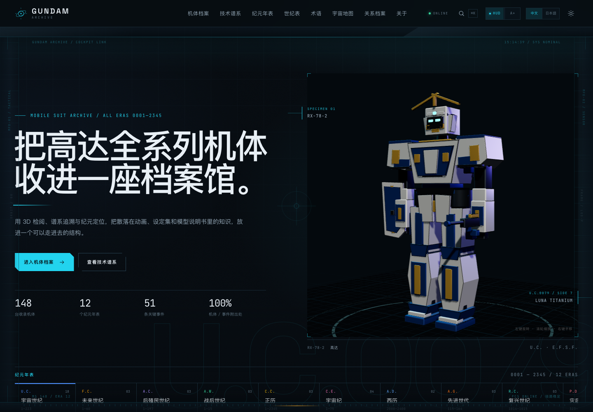
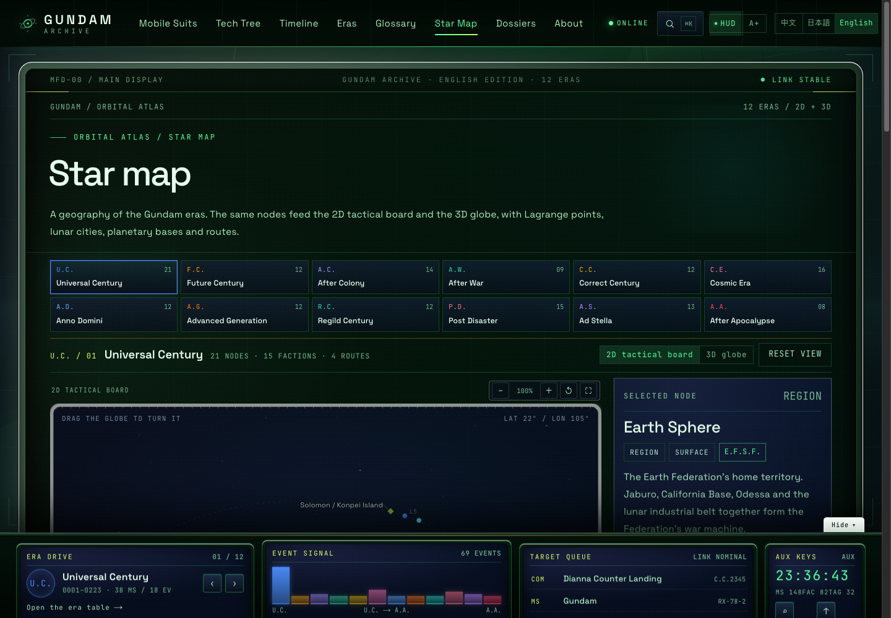
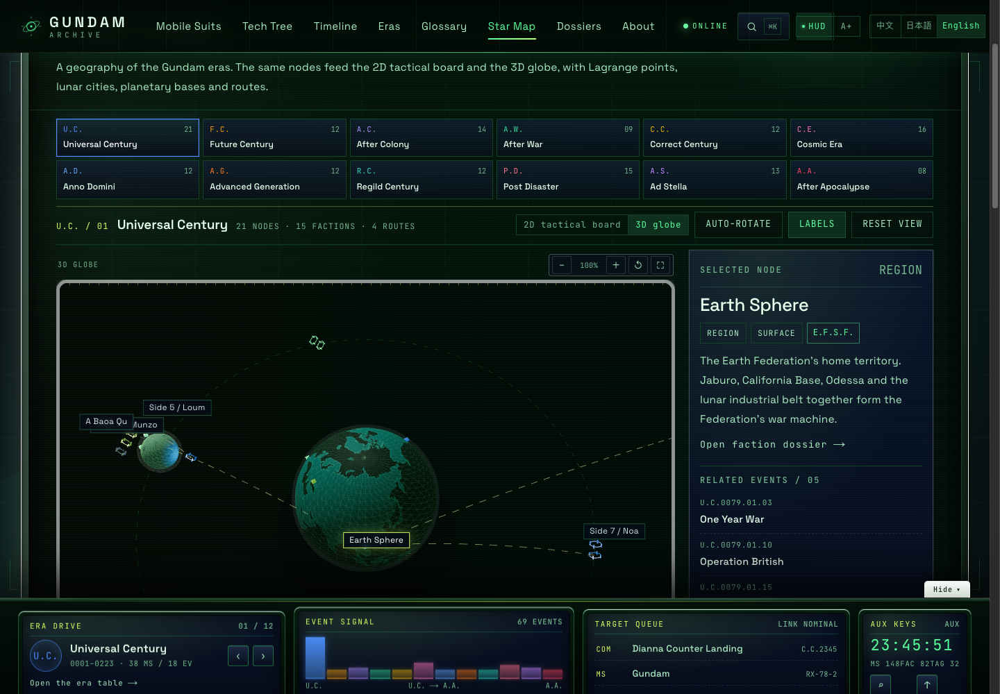
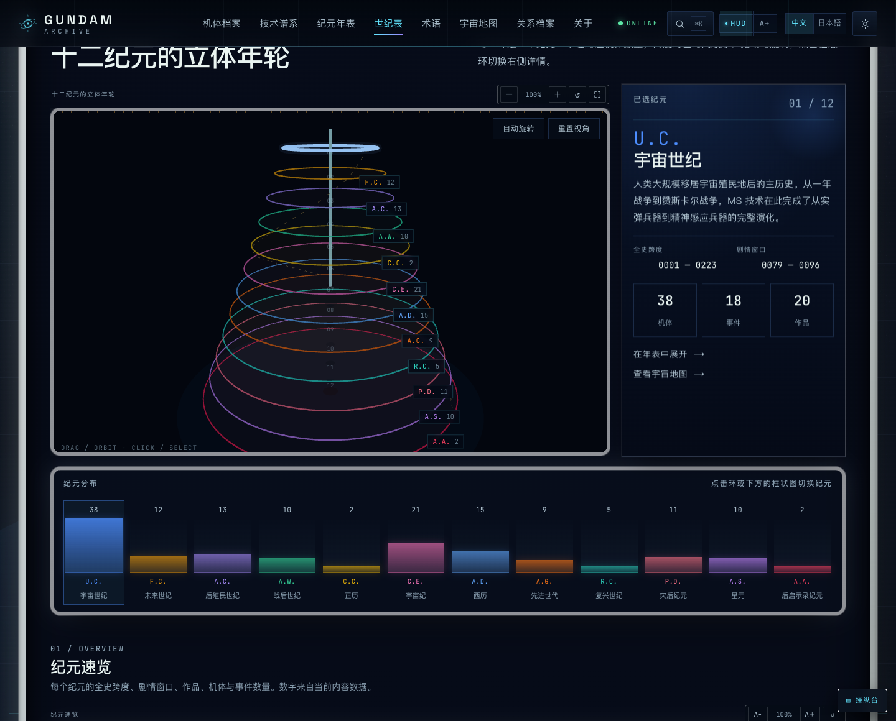
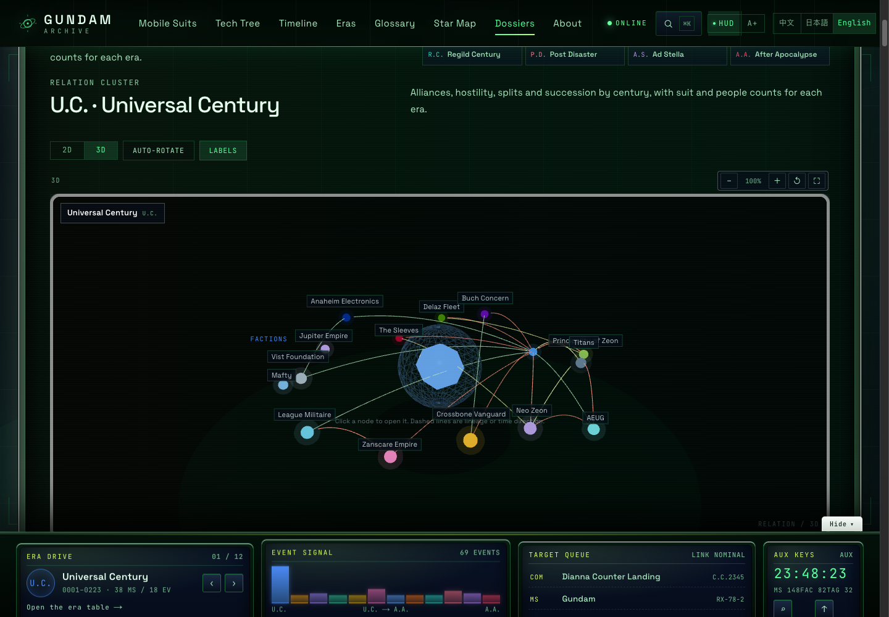
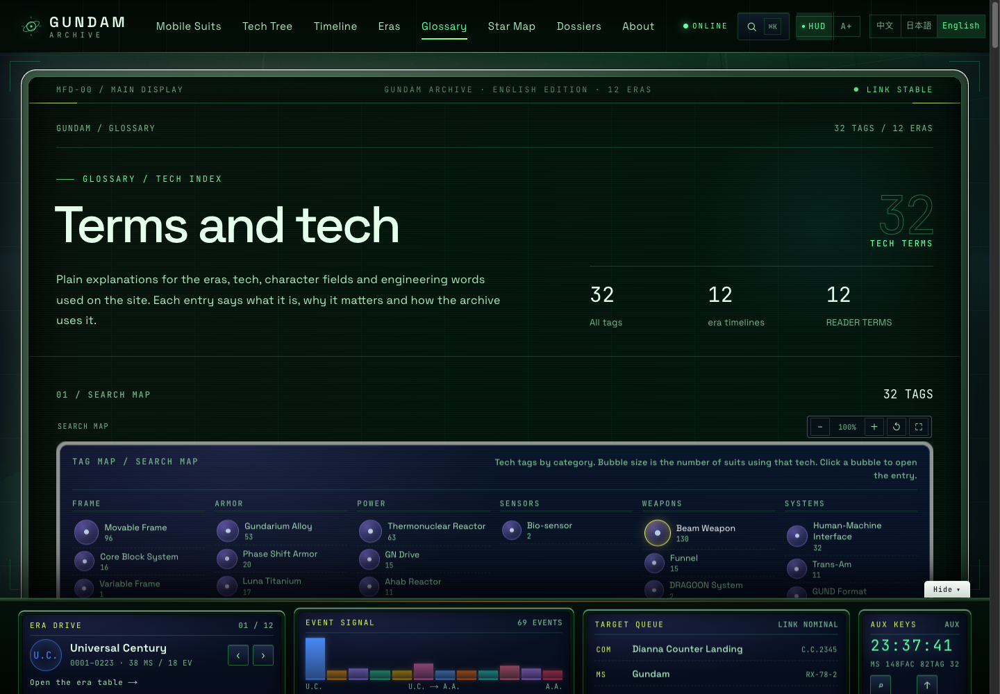
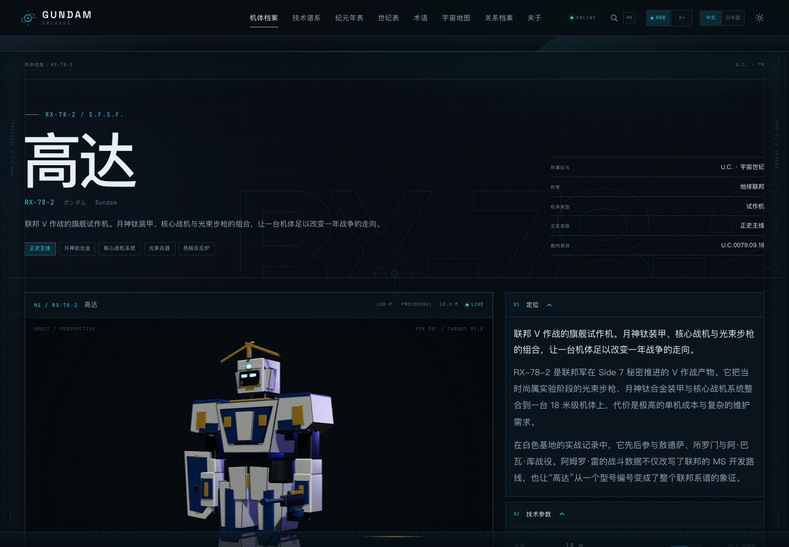
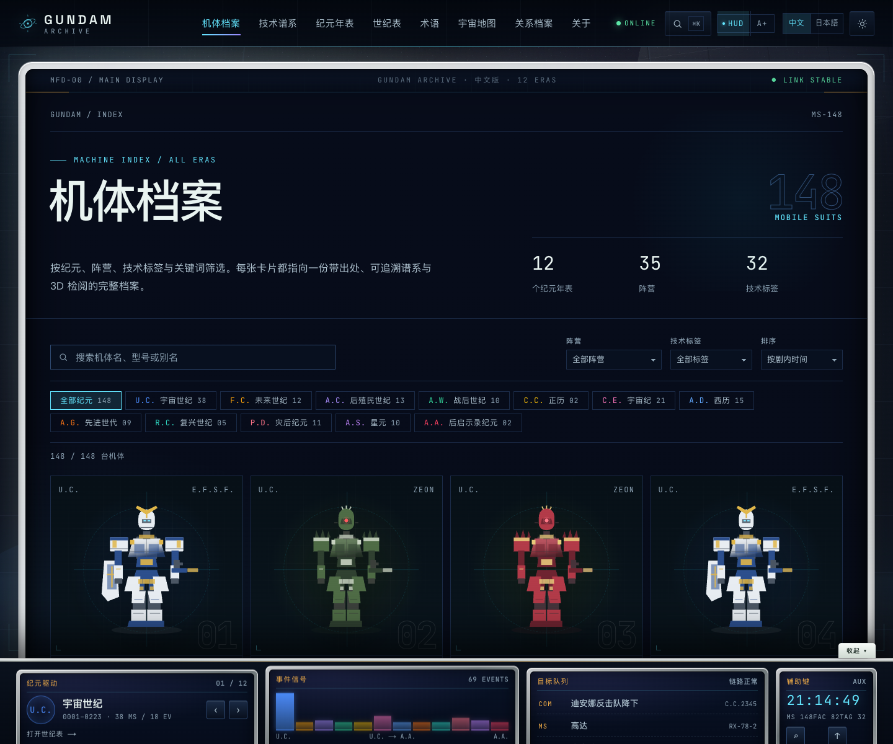

# GUNDAM Archive · Mobile Suit Archive

[中文](README.md) ｜ [日本語](README.ja.md) ｜ [English](README.en.md) ｜ [Live site](https://cxy2696.github.io/GUNDAM-archive/zh/) ｜ [GitHub](https://github.com/cxy2696/GUNDAM-archive) ｜ [Operations](docs/OPERATIONS.md)

> An interactive, traceable, operable archive of the Gundam multiverse.  
> 12-era 2D/3D atlas · 3D relationship graphs · tech tree · bilingual static site

**Next.js 15 · React 19 · TypeScript · Three.js / R3F · Zod · static export · JSON-driven**

> Unofficial fan research project, not affiliated with Bandai Namco or Sotsu・Sunrise. Code is MIT; original content is CC BY-NC-SA 4.0. See [NOTICE](NOTICE).

## Project description

**GUNDAM Archive** is an interactive, traceable and operable mobile-suit knowledge archive. It organizes machines, characters, events, factions and technology terms from 12 eras and 42 works into a structure that can be opened entry by entry and traced back to its sources — not another static data page.

The site is a fully static Next.js export. Content is maintained as JSON and validated by Zod at build time. It ships Chinese/Japanese routes, a procedural 3D viewer, a technology DAG, a chronology, a 2D/3D orbital atlas and relationship graphs. Adding an entry does not require changing page code; one `pnpm check` validates content, docs, types, language, links and every exported route.

Current version: **v3.1.3** (2026-11-12).  
Current snapshot: **148 machines · 12 eras · 114 characters · 42 works · 69 events · 82 factions · 32 controlled tags · 116 lineage edges · 156 atlas nodes**. The `/zh` and `/ja` site has **854 static pages**, **487 search entries** and **846 sitemap routes**.

## 30-second overview

- **What it is**: a JSON-driven Gundam archive that puts machines, chronology, lineage, characters and sources into one readable structure.
- **Where to start**: [Chronology](https://cxy2696.github.io/GUNDAM-archive/zh/chronology/) → [Atlas](https://cxy2696.github.io/GUNDAM-archive/zh/map/) → [Coverage rules](docs/MACHINE_COVERAGE.md).
- **Trust model**: machines and events carry `sources`; unchecked values are `seed`, disputed values are `disputed`, missing values render as “not documented” rather than estimates.
- **How to change it**: content lives in `content/`; see [CONTENT_GUIDE](docs/CONTENT_GUIDE.md). Release, rollback and troubleshooting are in [OPERATIONS](docs/OPERATIONS.md).

> **Scope**: 148 machines — 146 from 11 mainline eras plus 2 A.A. originals — covering mainline and core side stories. This is not a 5,000+ variant catalogue and contains no official artwork.

## What's new in v3.1

| Area | Current state |
| --- | --- |
| **Cockpit UI** | Frosted white main screen, canopy scanlines, side MFDs at ≥1760px, fixed console with a mobile drawer; status chrome on top, era drive/event signal/targets/aux keys below |
| **Space and occlusion** | Staggered MFD/console cards with a slight hover lift; the console can collapse so it never covers reading content; compact atlas header on mobile |
| **Zoom/fullscreen** | Maps, 3D globe, era wheel, relation graphs and tech tree have −/+/reset/fullscreen; chronology tables have A−/A+ text scaling |
| **3D graphs** | Machine, character, event, faction, glossary and archive relation graphs switch between 2D and 3D; 3D supports orbit, auto-rotate, label toggle and node navigation |
| **Atlas** | 12 eras, 156 nodes; every era has a 2D tactical board and a 3D WebGL globe. U.C. uses the One Year War layout with the 0084 Side 4/5/6 reassignment noted; C.E./A.D./R.C./P.D./A.W. follow documented geography |
| **Chronology** | 3D era wheel (radius = machine count, height = era order) plus a 12-column distribution; timeline labels anchor left/right with 54px rows |
| **Relations** | Era-switchable faction graph; alliance/hostility/split/succession lines; 82 factions, at least 5 per era |
| **Clusters** | Radial relation graphs and text indexes on machine, character, event, faction and glossary pages; 97/114 characters have relations |
| **Glossary/tech tree** | Category bubble map, relation tree, machine/alias search, generation bands, hover focus and fullscreen |
| **Search** | On-demand index; pilots, aliases, summaries, factions, tech and works; exact/prefix/multi-word/Latin fuzzy matching, type weighting and `?q=` links |
| **Content/model** | Events 51→69 (18 new), 20 events gained a second paragraph; procedural 3D add chest seams, cockpit hatch, shoulder verniers, knee guards and ankle actuators |
| **Maintenance** | Link and sitemap route audits, documentation count/version checks, pnpm 10 CI, Pages base-path build, release/rollback/monitoring/runbook |

## How to read the archive

1. **Start with the chronology**: era calendars, spans, works and machine counts; expand any era into its full machine roster.
2. **Open a machine page**: era, faction, first appearance, armaments, pilots, lineage edges, sources, 3D and 2D design sheet.
3. **Follow technology**: the [tech tree](https://cxy2696.github.io/GUNDAM-archive/zh/tech-tree/) highlights tags and links every edge back to two machines.
4. **Explore geography/relations**: switch 2D/3D eras in the [atlas](https://cxy2696.github.io/GUNDAM-archive/zh/map/), or open the [archive](https://cxy2696.github.io/GUNDAM-archive/zh/archive/) faction graph.
5. **Look up terms/events**: glossary search map and relation tree; timeline drawer or event dossiers.
6. **Contribute**: begin with [CONTENT_GUIDE](docs/CONTENT_GUIDE.md); adding a machine requires no page code.



## Screenshots

| Home · cockpit | Atlas · 2D |
| --- | --- |
|  |  |

| Atlas · 3D globe | Chronology · 3D era wheel |
| --- | --- |
|  |  |

| Relation graph · 3D | Glossary search map |
| --- | --- |
|  |  |

| Machine dossier | Machine index |
| --- | --- |
|  |  |

## Core capabilities

- **Inspect**: R3F viewer with orbit/zoom/pan, camera presets, auto-rotate, exploded view, part hover and wireframe; the 3D engine is lazy-loaded.
- **Quantum mode**: 0–100% interpolation across particles, energy rings, armor hue shift and emissive glow.
- **2D/3D link**: 3D, design sheet and split modes share `partId`; hover highlights both ways.
- **Technical composition**: power, armor, frame, systems and armament profile on every machine, linking to glossary tags.
- **Tech tree**: 148 machines and 116 edges; `derive_of` / `tech_from` / `replace`; build-time DAG validation.
- **Chronology**: 12 era lanes with their own year scales, decade/century ticks, mainline filter and event drawer.
- **Atlas**: 12 era maps; 2D and 3D share nodes. Lagrange assignments, C.E. L3/L4/L5, A.D. orbital elevators, R.C. energy chain and P.D. Mars/Second Moon follow documented settings.
- **Archive**: era faction graph, organization tree, five relation types, character tenures and work index.
- **Characters**: 114 profiles with age, rank, origin, service record, machines and chronological events.
- **Events**: 69 dossiers with background/outcome, participants, machines, characters, sources and previous/next events.
- **Glossary**: 32 controlled technology tags with explanations, category filters, search map, relation tree and 12 reading terms.
- **HUD/reading mode**: HUD toggle, scanlines, reticle, link status; `A+ / A−` large-text mode scales body and cards.
- **Chinese/Japanese routes**: `/zh` and `/ja`, hreflang/canonical, language switch preserving path, query, hash and scroll position.

## Quick start

Requires Node.js 22 (minimum 20.9) and pnpm 10.

```bash
git clone https://github.com/cxy2696/GUNDAM-archive.git
cd GUNDAM-archive

pnpm install
pnpm dev              # http://localhost:3000; predev builds the search index
pnpm check            # validate → docs → typecheck → language → build → links → routes
pnpm preview          # serve out/ locally (python3)
```

Sub-path verification:

```bash
NEXT_PUBLIC_BASE_PATH=/GUNDAM-archive NEXT_PUBLIC_SITE_URL=https://cxy2696.github.io/GUNDAM-archive pnpm build
NEXT_PUBLIC_BASE_PATH=/GUNDAM-archive pnpm links:check
NEXT_PUBLIC_BASE_PATH=/GUNDAM-archive pnpm routes:check
```

## Content as data

Adding a machine does not require page code:

1. Copy [docs/templates/machine.template.json](docs/templates/machine.template.json) to `content/machines/<slug>.json`.
2. Fill names, specs, armaments, tags, pilots, events, viewer config and `sources`; use `null` for missing values.
3. Add lineage edges on related machines; every edge needs `sources` and a valid `to`.
4. If the machine participates in an event, add its `machineIds` in `content/events.json` and keep the relation bidirectional.
5. Run `pnpm check` and sync the counts following [CONTENT_GUIDE](docs/CONTENT_GUIDE.md).

Fields: [DATA_DICTIONARY](docs/DATA_DICTIONARY.md). Source levels: [GOVERNANCE](docs/GOVERNANCE.md). Editorial rules: [EDITORIAL](docs/EDITORIAL.md).

## Architecture

```text
content/*.json ──Zod──▶ src/lib/content.ts ──▶ Server Components ──▶ next build
      │                         │
      ├─ atlas.json ──▶ geo.ts / Atlas2D / Atlas3D
      ├─ graph builders ──▶ RelationGraph / RelationGraph3D
      └─ build-search-index.ts ──▶ public/search-index.*.json (on-demand fetch)
```

- **Single source of truth**: `src/lib/schema.ts` constrains both the data and TypeScript types.
- **Static first**: no database or server runtime; updates are JSON → validation → rebuild.
- **Lazy 3D**: page shell and R3F stage are split; maps/graphs switch to 3D on demand.
- **Contract first**: procedural LOD-P and future glTF share `partId / axis / order / manifest`.
- **Auditable**: `links:check` and `routes:check` run after build in CI and Pages.

See [ARCHITECTURE](docs/ARCHITECTURE.md).

## Documentation and operations

The **canonical documentation is Chinese**; this English README is the international entry point. An English index is at [docs/README.en.md](docs/README.en.md).

| Document | Responsibility |
| --- | --- |
| [docs/README](docs/README.md) | Documentation index, authority order, maintenance matrix |
| [docs/OPERATIONS](docs/OPERATIONS.md) | Release, rollback, monitoring, troubleshooting, periodic maintenance |
| [docs/ARCHITECTURE](docs/ARCHITECTURE.md) | Layers, data flow, viewer, deployment, ADRs |
| [docs/CONTENT_GUIDE](docs/CONTENT_GUIDE.md) | Adding/editing content, bilingual rules, review checklist |
| [docs/DATA_DICTIONARY](docs/DATA_DICTIONARY.md) | Fields, enums, atlas, validation |
| [docs/DESIGN_SYSTEM](docs/DESIGN_SYSTEM.md) | Tokens, cockpit shell, charts, accessibility, motion |
| [docs/ROADMAP](docs/ROADMAP.md) / [CHANGELOG](CHANGELOG.md) | Next steps / released changes |
| [CONTRIBUTING](CONTRIBUTING.md) | Contribution flow, commands, PR checklist |

## Quality gates and operations

`pnpm check` runs seven gates:

1. **Content** — schema, foreign keys, lineage DAG, bidirectional links, explanation fields, plus a redundancy audit for duplicate names/text/relations/sources and echoed summaries.
2. **Docs** — Markdown links, required documents, version and content-count snapshots.
3. **Types** — `typecheck`.
4. **Language** — template phrases, overlong summaries/paragraphs.
5. **Build** — 854 static pages and the search index.
6. **Links** — every internal href and `#fragment`.
7. **Routes** — every sitemap route has an exported document with `<title>` and `<main>`.

CI and Pages run the same gates; Pages additionally builds with `NEXT_PUBLIC_BASE_PATH`. See [OPERATIONS](docs/OPERATIONS.md).

## Deployment

| Platform | Method |
| --- | --- |
| GitHub Pages | `.github/workflows/deploy-pages.yml` sets `NEXT_PUBLIC_BASE_PATH=/GUNDAM-archive` |
| Vercel / Cloudflare / Netlify | build `pnpm build`, output `out` |

| Variable | Purpose | Default |
| --- | --- | --- |
| `NEXT_PUBLIC_BASE_PATH` | sub-path prefix | empty |
| `NEXT_PUBLIC_SITE_URL` | canonical / sitemap / OG origin | `https://cxy2696.github.io/GUNDAM-archive` |

## Known boundaries

- **Scope**: 148 machines (146 mainline, 2 A.A.); mainline and core side stories, not a 5,000+ variant catalogue.
- **3D is procedural LOD-P placeholder**, not an official model; parts/axes/explode order follow `partId`, so LOD0 can replace it without changing the viewer.
- **No official artwork**: visuals are self-drawn SVG/procedural 3D; official images and wiki images are not mirrored or hot-linked.
- **Seed data**: specs are compiled from public material, not page-checked against every setting book; UI shows `seed`/`disputed`.
- **Incomplete source coverage**: machines and events require `sources`; factions/characters/works/places/tags are anchored by work/era rather than per-entry `source_refs`.
- **No backend/database/admin**: search is an on-demand index; updates require a rebuild. Pinyin/romaji fuzzy search, visual regression and real-device performance gates are not yet integrated.

## License

- **Code**: [MIT](LICENSE)
- **Original text, charts, SVG and procedural geometry**: [CC BY-NC-SA 4.0](https://creativecommons.org/licenses/by-nc-sa/4.0/)
- **Gundam names and settings**: belong to Sotsu・Sunrise / Bandai Namco. This is a non-commercial fan project with no official artwork or model assets. See [NOTICE](NOTICE).
