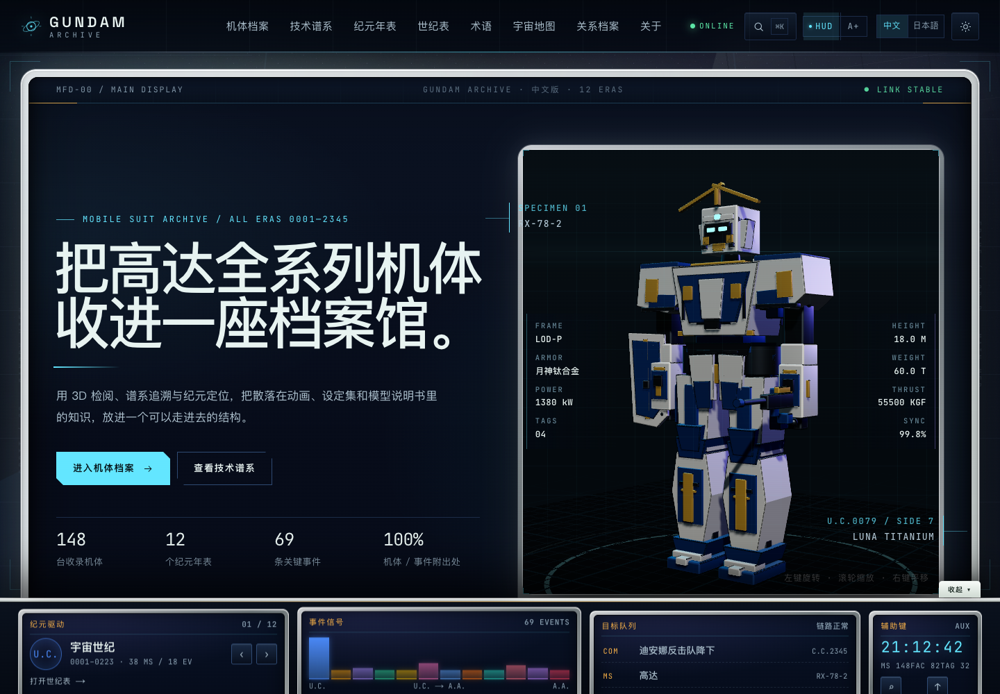
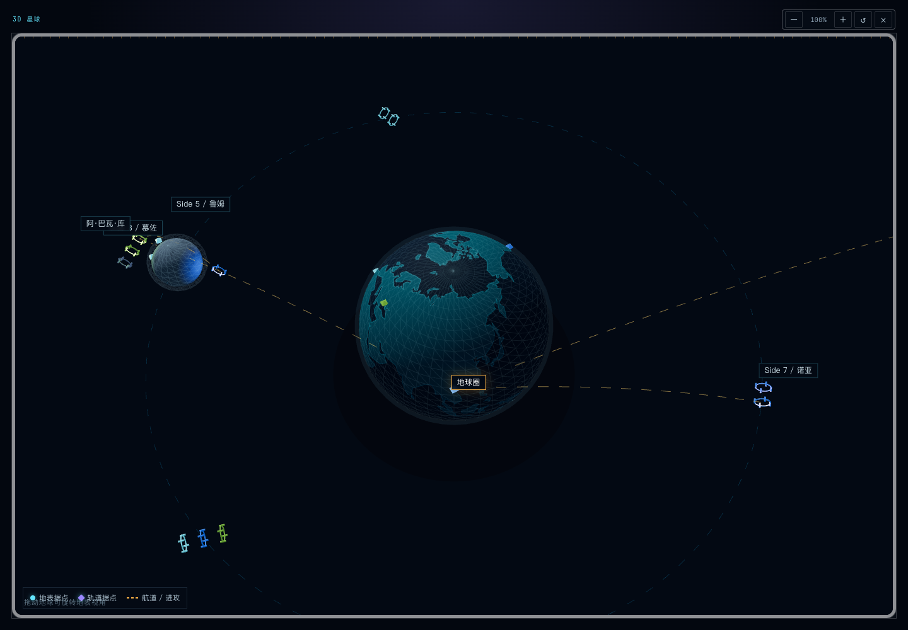
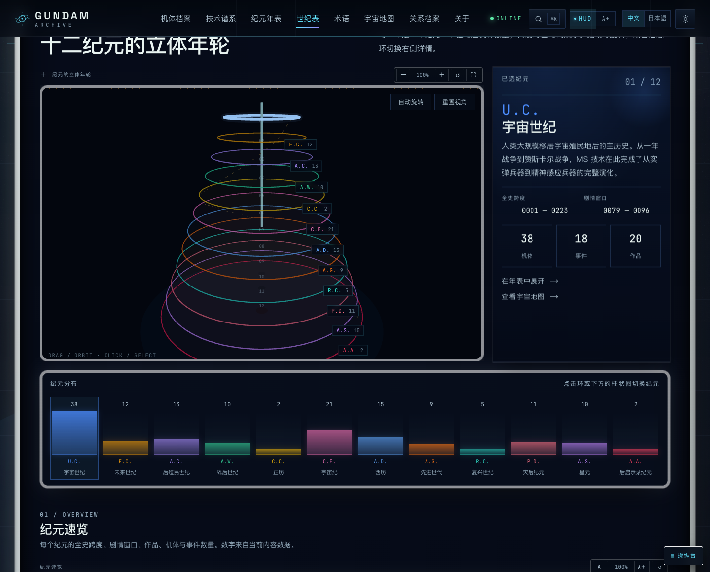
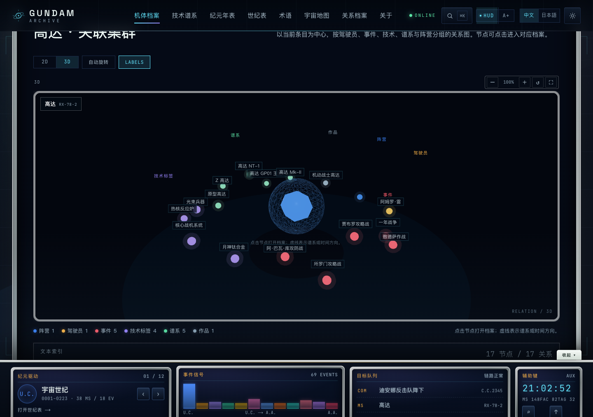
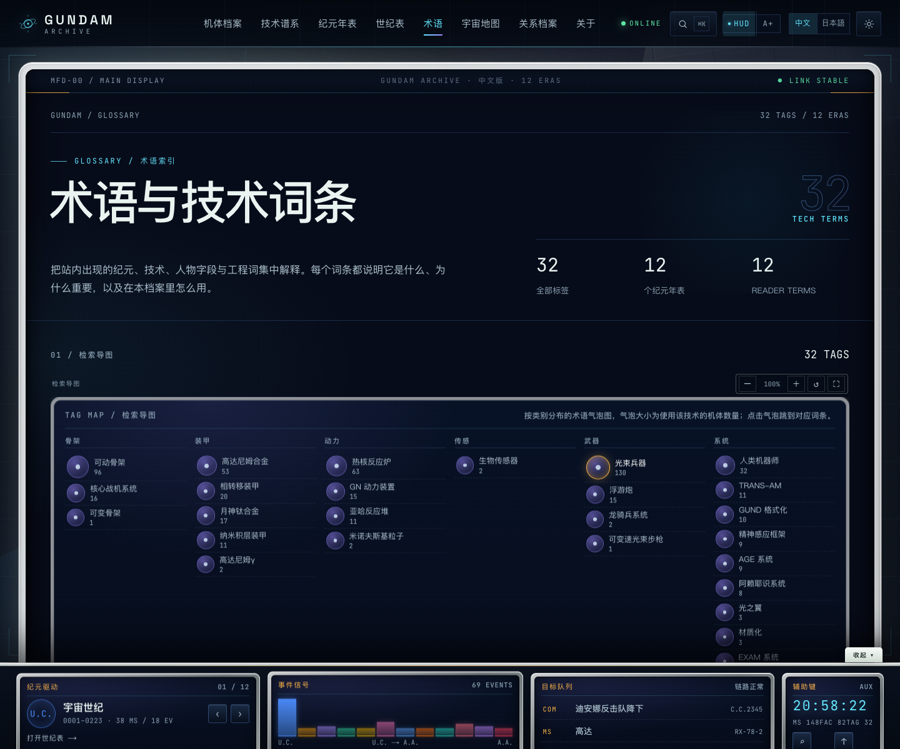

# GUNDAM Archive · モビルスーツアーカイブ

[中文](README.md) ｜ [日本語](README.ja.md) ｜ [ライブサイト](https://cxy2696.github.io/GUNDAM-archive/ja/) ｜ [GitHub](https://github.com/cxy2696/GUNDAM-archive)

> ガンダム各紀元の機体史を、たどれる構造へ。  
> 3D閲覧 · 技術系譜 · 紀元年表 · 地球圏地図 · 中／日バイリンガル

**Next.js 15 · React 19 · TypeScript · Three.js / R3F · Zod · 静的書き出し · JSON駆動**

> 非公式のファン考証プロジェクトです。バンダイナムコ／創通・サンライズとは無関係です。コードは MIT、オリジナルコンテンツは CC BY-NC-SA 4.0。詳細は [NOTICE](NOTICE) を参照してください。

## 5分でわかる

- **これは何か**：JSON駆動の静的ガンダムアーカイブ。機体・紀元・系譜・出典を一つの読みやすい構造にまとめる。
- **これは何ではないか**：公式資料庫ではなく、5,000件超の全派生型図鑑でもなく、公式デザイン画像も含まない。
- **どこから読むか**：全紀元の俯瞰は[世紀表](https://cxy2696.github.io/GUNDAM-archive/ja/chronology/)、全機体は[機体総表](https://cxy2696.github.io/GUNDAM-archive/ja/chronology/#roster-title)、収録範囲は[MACHINE_COVERAGE](docs/MACHINE_COVERAGE.md)。
- **信頼性**：機体と事件には出典を付す。未確認値は `seed`、係争値は `disputed`。



## 概要

ガンダムシリーズは複数の紀元と作品にわたり、公式・非公式の資料がアニメ、設定資料集、模型説明書、コミュニティWikiへ散在しています。機体諸元の口径は揃わず、紀元年表は分断され、技術の進化は十数作品を往復しないと追えません。

GUNDAM Archive は、その知識を**閲覧でき、追跡でき、育てられる**構造へ組み直します。

| 主線 | 問い | 機能 |
| --- | --- | --- |
| **閲覧** Inspect | どんな機体で、何でできているか | 3Dビューア、分解、部位ハイライト、量子形態、2Dレイヤー設計図 |
| **追跡** Trace | どこから来て、どこへ続くか | 技術タグ付きDAG、3種類の辺、全辺に出典 |
| **定位** Locate | いつ、どの戦争、どこで | 十二紀元の年表、地球圏／ラグランジュ点の示意地図、事件ドロワー |

A.A.（アフター・アポカリプス）は本リポジトリのオリジナル拡張紀元です：XARX-0ガンダムZERO、螺旋ガンダム、『機動戦士ガンダムRG XARX-ZERO』『GUNDAM ROGUE ORBIT』。11の正史紀元とは分けて読んでください。

収録内容：**148機体 · 12紀元 · 114人物 · 42作品 · 69事件 · 82勢力 · 32技術タグ · 116系譜辺 · 156地図ノード**。`/zh` と `/ja` の二言語、**854ページ**の静的サイト、ビルド時に**487件**の検索索引を生成します。

## 今回の更新（V3.1）

| 項目 | 内容 |
| --- | --- |
| **コックピットUI** | キャノピー視点、金属ベゼルの主画面、MFDサイドレール（1760px以上）、固定コンソール。モバイルではコンソールをドロワー化。上部にMFDステータス、下部に紀元ドライブ／イベント信号／ターゲット／補助キー |
| **白いフロスト枠と浮遊感** | 主画面、地図、系譜、世紀表、関連図、コンソールを白い半透明フレームで包み、MFDとコンソールカードを上下にずらして配置。コンソールは「収納」でき本文を隠さない |
| **ズームと全画面** | 地図/3D惑星/関連図/紀元年輪に − / + / リセット / 全画面。世紀表はA− / A+の文字拡大、技術系譜はズーム・幅合わせ・全画面 |
| **関連図の3D** | 機体・人物・事件・勢力・用語・関係档案の関連図を2D/3D切替。3Dは回転・自動回転・ラベル切替・ノード遷移に対応 |
| **文字と可読性** | 本文17px、マイクロラベル12px、ボタン・表・ナビ13–15pxへ拡大。`A+ / A−` の大字モード、表・年表・系譜・関係図も新字号で再配置 |
| **宇宙地図** | `/[lang]/map` を12紀元の星図へ刷新。156ノード、U.C.からA.A.まで各紀元に**2D戦術盤＋3D WebGL惑星**。U.C.は一年戦争（0084年以前）配置と0084年のサイド4/5/6再編を注記。C.E.、A.D.、R.C.、P.D.、A.W.も公式地理に合わせて修正 |
| **世紀表 / 年表** | 世紀表に**3D紀元年輪**を追加。12リングを機体数と世紀順で配置し、回転・クリック選択・自動回転に対応。下部に12列の機体分布図。年表はラベルを左右に寄せ、行間54pxで右端の重なりを解消 |
| **関係档案** | 世紀別の**勢力関係図**を追加。同盟・敵対・分裂・継承を色分けし、機体数・人物数を表示。勢力は57から**82**へ拡張し、全紀元で5勢力以上 |
| **関連クラスタ** | 機体・人物・事件・勢力・用語ページに放射状の**関連クラスタ図**を追加。パイロット／事件／技術／系譜／陣営で分区し、テキスト索引とクリック可能なノードを併設。人物関係は18人から**97人**へ |
| **用語検索** | 用語ページに**検索マップ**（カテゴリ別バブル、大きさ＝使用機体数）と**関連ツリー**（使用機体・勢力・紀元・共起技術）を追加 |
| **技術系譜** | 機体名・型番検索、−/+/幅合わせズーム、世代目盛り、ホバーで直系関係を強調。12紀元タブはデスクトップで折り返し |
| **検索** | パイロット、別名、要約、詳細、勢力、技術、作品まで索引化。完全一致／前方一致／複数語／ラテン語の綴り揺れ、種別重み、`?q=`共有、クイックアクセス、紀元ショートカット |
| **ズームと3D** | 地図、技術系譜、世紀表、用語マップ、すべての関連図がズーム対応（地図・年輪・関連図は全画面可）。関連図は2D/3Dを切替でき、3Dは回転・自動回転・ラベル表示切替に対応 |
| **モデル** | 手続き生成3D機体に胸甲の継ぎ目、コクピットハッチ、肩スラスター、肘／前腕装甲、膝甲、すねの放熱口、足首アクチュエータ、バックパックノズル、頬部ダクトを追加 |
| **事件** | 事件を51から**69**へ拡充。ヘリオポリス、スピットブレイク、メサイア、堕ちた天使、ドルト蜂起、ヴィーンゴールヴ、ハシュマル、クイン・ハーバー、アスティカシア、リーブラ、サンク、クラウド9、ディアナ降下、ノーラ、ザンクト・ポルト、シャッフル同盟など18件を追加。主要20事件に経過／結果の段落も追加 |
| **二言語** | 上記UI文案と追加内容は中国語・日本語の両方に対応。言語ゲートと内容検証は継続して通過 |

| 宇宙地図 · 3D | 世紀表 · 3D年輪 |
| --- | --- |
|  |  |

| 関連クラスタ · 3D | 用語検索マップ |
| --- | --- |
|  |  |

## 主な機能

- **3Dビューア**：回転、ズーム、パン、視点プリセット、自動回転、分解、部位ホバー、ワイヤーフレーム。3Dエンジンは遅延読み込みで、ページ本体の表示を妨げません。
- **量子形態**：0–100%の連続補間。粒子、エネルギーリング、装甲の色相偏移、発光を同期。コンソールからいつでもオフにできます。
- **2D／3D連動**：3D・設計図・分割の3モード。SVGレイヤーと3Dが `partId` を共有し、ホバーが双方向に同期。製図モード付き。
- **技術構成**：各機体に動力、装甲、フレーム、システム、武装構成のパネルを用意。技術タグから用語ページへ移動できる。
- **技術系譜**：紀元ごとに切り替えるDAG。148機体・116辺、`derive_of` / `tech_from` / `replace` の3種の辺、タグハイライト、ビルド時の循環検査。
- **紀元年表**：十二紀元の泳道がそれぞれの紀年尺度を保持。年／十年／世紀の目盛り、主線フィルタ、U.C.全史切替、事件詳細。
- **関係档案**：勢力の組織樹、5種類の関係、人物の任期と搭乗機体、作品索引。`⌘K` 検索と検索ページ。
- **人物経歴**：114人物の年齢・階級・出身と「服役記録」。搭乗機体と関連事件を時系列に並べ、事件档案へ直接リンク。
- **事件档案**：69事件すべてに長文の「事件の経過」と独立档案ページ。結果、参戦勢力、関連機体、人物、出典、前後事件を収録。
- **用語・技術項目**：32の統制タグを装甲・動力・センサー・兵器・システム・フレームで分類し、検索可能。12の読解用語も収録。
- **コックピットHUD / 読書モード**：HUD切替、スキャンライン、レティクル、リンク状態。`A+ / A−` で本文とカードを拡大。
- **中／日切替**：`/zh` と `/ja` のルート、hreflang／canonical。ヘッダー、モバイルメニュー、フッターから切替でき、パス・クエリ・アンカー・スクロール位置を保持。初回はブラウザ言語で入口を選択。

## クイックスタート

Node.js 20.9以上（22推奨）。

```bash
git clone https://github.com/cxy2696/GUNDAM-archive.git
cd GUNDAM-archive

pnpm install
pnpm dev            # http://localhost:3000
pnpm validate       # schema / 外部参照 / 系譜 / 双方向関連
pnpm language:check # 編集言語ゲート（テンプレート句・長さ）
pnpm typecheck
pnpm build          # out/ へ静的書き出し
pnpm preview        # out/ をローカル表示（python3 が必要）
```

## コンテンツはデータ

機体の追加にページコードの変更は不要です。

1. [docs/templates/machine.template.json](docs/templates/machine.template.json) を `content/machines/<slug>.json` にコピー。
2. 名称、諸元、武装、タグ、パイロット、事件、ビューア設定、`sources` を記入。無い数値は `null` のままにし、推測で埋めません。
3. 系譜辺を追加。辺には `sources` が必須で、`to` は既存機体を指します。
4. 事件に参加する場合は `content/events.json` の `machineIds` も更新し、双方向参照を保ちます。
5. `pnpm validate && pnpm build` を実行。

ルート、カード、検索索引、系譜図、年表、地図、勢力・人物ページは自動で新データを読みます。項目定義は [DATA_DICTIONARY](docs/DATA_DICTIONARY.md)、手順は [CONTENT_GUIDE](docs/CONTENT_GUIDE.md)（いずれも中国語）を参照。

## アーキテクチャ

```
content/*.json
   │  ビルド時のみ fs で読込
   ▼
src/lib/schema.ts      Zod schema + 型（唯一の真実源）
src/lib/content.ts     解析・外部参照・系譜・双方向の検証
src/lib/tree.ts        DAGレイアウト
src/lib/search-index.ts
   ▼
app/(site)/[lang]      React Server Components → 854ページ
   ▼
next build (output: export) → out/ → GitHub Pages
```

- **単一の真実源**：`src/lib/schema.ts` がデータ構造とTypeScript型を同時に拘束。
- **静的優先**：DBもサーバーランタイムも不要。更新は JSON → 検証 → 再ビルド。
- **3Dは遅延読込**：ページシェルとR3F Stageを分離。
- **契約先行**：暫定LOD-Pと将来のglTFが `partId / axis / order / manifest` を共有。

詳細は [ARCHITECTURE](docs/ARCHITECTURE.md)（中国語）。

## ドキュメント

| ドキュメント | 内容 |
| --- | --- |
| [README.md](README.md) | 中国語の総合入口 |
| [docs/README.md](docs/README.md) | ドキュメント索引・権威の境界・更新ルール |
| [docs/EDITORIAL.md](docs/EDITORIAL.md) | 編集方針・禁止テンプレート・事実と長さの規則 |
| [docs/CHRONOLOGY.md](docs/CHRONOLOGY.md) | 十二紀元の世紀表・紀元別速覧・読み方 |
| [docs/MACHINE_COVERAGE.md](docs/MACHINE_COVERAGE.md) | 「全機体」の収録規則・カバレッジ・含まないもの |
| [docs/ARCHITECTURE.md](docs/ARCHITECTURE.md) | 六層モデル、データフロー、ビューア、デプロイ、ADR |
| [docs/CONTENT_GUIDE.md](docs/CONTENT_GUIDE.md) | コンテンツ追加、二言語、レビュー、よくあるエラー |
| [docs/DATA_DICTIONARY.md](docs/DATA_DICTIONARY.md) | フィールド、列挙、単位、日付、検証規則 |
| [docs/ASSET_PIPELINE.md](docs/ASSET_PIPELINE.md) | LOD、partId、manifest、Blender→glTF |
| [docs/DATA_SOURCES.md](docs/DATA_SOURCES.md) | 外部資料源、取込手順、公式画像の権利境界 |
| [docs/GLOSSARY.md](docs/GLOSSARY.md) | 紀元・フィールド・技術用語の平易な説明 |
| [docs/GOVERNANCE.md](docs/GOVERNANCE.md) | 出典区分、係争、著作権、レビュー |
| [docs/DESIGN_SYSTEM.md](docs/DESIGN_SYSTEM.md) | Token、タイポグラフィ、コンポーネント、動き、a11y |
| [docs/ROADMAP.md](docs/ROADMAP.md) | M0–M5、V1.1、コンテンツバッチ、リスク |
| [CONTRIBUTING.md](CONTRIBUTING.md) | 開発・コンテンツ貢献の手順 |
| [CHANGELOG.md](CHANGELOG.md) | 変更履歴 |

> ドキュメントは中国語を主言語とし、日本語はこのREADMEとサイトUIで提供します。フィールド表はDATA_DICTIONARYだけに置き、他の文書では繰り返しません。

## 既知の境界

- **範囲**：現在は**147機体**（11の正史紀元で145機、A.A.拡張で2機）を収録しています。主線と主要外伝はカバーしますが、文字通りの5,000件超の全派生型ではありません。収録規則は [MACHINE_COVERAGE](docs/MACHINE_COVERAGE.md) を参照。
- **年齢・階級・出身は公開設定の整理**です。「約」は推定値で、作品間の口径が異なる場合は `seed` として提示し、無理に統一しません。
- **事件の長解説は編集による再構成**であり、公式原文ではありません。設定資料集や本編の代替ではありません。
- **公式デザイン画像は収録しません**。現在のビジュアルは自作SVG／プロシージャル3Dで、公式画像・設定集スキャン・Wiki画像の転載や直リンクは行いません。詳細は [DATA_SOURCES](docs/DATA_SOURCES.md)。
- **3DはプロシージャルLOD-Pの暫定アセット**です。公式モデルでも最終glTFでもありません。部位・組立軸・分解順は `partId` で整理済みで、LOD0接続時にビューアを書き換える必要はありません。
- **データはシードデータ**です。公開資料に基づきますが、設定資料集の頁まで逐項確認していません。UIには `seed` / `disputed` を表示します。
- **出典の網羅性は未完成**です。機体と事件には `sources` がありますが、勢力・人物・作品・地点・タグは作品への紐付けのみで、項目ごとの `source_refs` は未整備です（M4）。
- バックエンド／DB／Adminはありません。検索はビルド時索引で、更新は再ビルドです。
- ピンイン・ローマ字の曖昧検索、視覚回帰、実機性能ゲートは未対応です。

## ライセンス

- **コード**：[MIT](LICENSE)
- **オリジナルの文章・図表・SVG・プロシージャル形状**：[CC BY-NC-SA 4.0](https://creativecommons.org/licenses/by-nc-sa/4.0/)
- **ガンダムシリーズおよび関連名称・設定**：創通・サンライズ／バンダイナムコに帰属。本プロジェクトは非商業のファン作品で、公式美術・模型素材を含みません。完全な声明は [NOTICE](NOTICE)。
