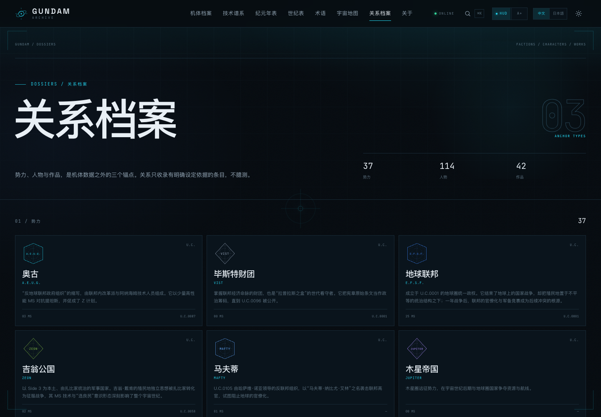

# GUNDAM Archive · 机动战士档案

[中文](README.md) ｜ [日本語](README.ja.md) ｜ [在线站点](https://cxy2696.github.io/GUNDAM-archive/zh/) ｜ [GitHub](https://github.com/cxy2696/GUNDAM-archive) ｜ [运营手册](docs/OPERATIONS.md)

> 可交互、可追溯、可运营的高达全系列档案。  
> 12 纪元宇宙地图（2D/3D）· 3D 关联图谱 · 技术谱系 · 双语静态站

**Next.js 15 · React 19 · TypeScript · Three.js / R3F · Zod · 静态导出 · JSON 驱动**

> 非官方粉丝考据项目，与 Bandai Namco / 创通・Sunrise 无关联。代码 MIT，原创内容 CC BY-NC-SA 4.0。详见 [NOTICE](NOTICE)。

## 项目描述

**GUNDAM Archive** 是一个可交互、可追溯、可运营的机动战士知识档案。它把横跨 12 个纪元、42 部作品的机体、人物、事件、势力与技术词条整理成可逐条打开、可回到出处的结构，而不是再做一个静态资料页。

站点是纯静态的 Next.js 导出：内容用 JSON 维护、Zod 在构建期校验，页面带中日双语、3D 机体查看器、技术谱系、纪元年表、2D/3D 宇宙地图与关系图谱。新增一条内容不需要改页面代码；一次 `pnpm check` 会同时检查内容、文档、类型、语言、链接与全部导出路由。

当前版本：**v3.1.1**（2026-11-12）。  
当前快照：**148 台机体 · 12 个纪元 · 114 位人物 · 42 部作品 · 69 条事件 · 82 个势力 · 32 个受控标签 · 116 条谱系边 · 156 个地图节点**；`/zh` 与 `/ja` 双语，共 **854 个静态页面**、**487 条检索索引**、**846 条 sitemap 路由**。

## 30 秒读懂

- **这是什么**：JSON 驱动的高达档案站，把机体、纪年、谱系、人物与出处放进同一套可读结构。
- **先看哪三页**：[世纪表](https://cxy2696.github.io/GUNDAM-archive/zh/chronology/) 看全系列 → [宇宙地图](https://cxy2696.github.io/GUNDAM-archive/zh/map/) 看 12 纪元 2D/3D 地理 → [覆盖说明](docs/MACHINE_COVERAGE.md) 看收录边界。
- **可信度**：机体与事件有 `sources`；未核对参数标 `seed`，冲突标 `disputed`；没有的参数显示“资料未载”，不估算。
- **怎么改**：内容在 `content/`，说明在 [CONTENT_GUIDE](docs/CONTENT_GUIDE.md)；发布/回滚/排障在 [OPERATIONS](docs/OPERATIONS.md)。

> **范围**：收录 11 个正史纪元的高达型主线机体与核心外传机体，另保留 2 台 A.A. 原创扩展。不是 5,000+ 全衍生型号图鉴，也不含官方设计图。收录规则见 [MACHINE_COVERAGE](docs/MACHINE_COVERAGE.md)。

## 这次更新（V3.1）

| 方向 | 现在有什么 |
| --- | --- |
| **座舱界面** | 毛玻璃白框主屏、舱盖/扫描线、侧 MFD（≥1760px）、固定操纵台（移动端抽屉）；主屏顶部有状态条，底部可切换纪元、看事件分布、跳最新事件 |
| **空间与遮挡** | MFD 侧栏与操纵台卡片上下错落、hover 轻微上浮；操纵台可“收起”，正文不被遮挡；移动端压缩地图页头部 |
| **缩放/全屏** | 地图、3D 星球、纪元年轮、关联图、技术谱系都有 −/+/重置/全屏；世纪表有 A−/A+ 文字缩放 |
| **关联图 3D** | 机体、人物、事件、势力、术语、关系档案的关联图全部可 2D/3D 切换；3D 支持旋转、自动旋转、标签开关与节点跳转 |
| **宇宙地图** | 12 个纪元、156 个节点；每个纪元都有 2D 战术盘 + 3D WebGL 星球。U.C. 使用一年战争编制并注明 0084 年 Side 4/5/6 重编；C.E./A.D./R.C./P.D./A.W. 按设定校正 |
| **世纪表/年表** | 3D 纪元年轮（环半径=机体数、高度=纪元顺序）+ 12 列机体分布图；年表标签左右锚定、54px 行距，不再堆在右缘 |
| **关系档案** | 按世纪切换的势力关系图；同盟/敌对/分裂/继承分色；势力 82，每纪元至少 5 个 |
| **关联集群** | 机体、人物、事件、势力、术语页新增放射状关联图，附文本索引与可点击节点；人物关系覆盖 97/114 |
| **术语/技术谱系** | 术语页新增检索导图与关联树；技术谱系新增搜索、缩放、代际标尺、悬停直连、全屏 |
| **检索** | 按需加载索引；索引驾驶员、别名、摘要、势力、技术、作品；精确/前缀/多词/拉丁模糊匹配、类型加权、`?q=` 分享 |
| **内容与模型** | 事件 51→69（新增 18 条），20 个事件补第二段经过；程序化 3D 机体补胸甲接缝、驾驶舱盖、肩喷口、膝甲、脚踝作动筒等 |
| **可维护/可运营** | 链接与 sitemap 路由审计、文档计数校验、pnpm 10 CI、Pages 基路径构建、发布/回滚/监控/排障手册 |

## 怎么读这个站

1. **先看世纪表**：每个纪元的历法、跨度、作品与机体数量；再展开任一纪元的全机体总表。
2. **再进机体页**：纪元、势力、初登场、武装、驾驶员、谱系边、出处与 3D/2D 设计图。
3. **追技术路线**：打开[技术谱系](https://cxy2696.github.io/GUNDAM-archive/zh/tech-tree/)，按标签高亮；每条边回到两台机体。
4. **看地理/关系**：在[宇宙地图](https://cxy2696.github.io/GUNDAM-archive/zh/map/)切换 2D/3D 与纪元；在[关系档案](https://cxy2696.github.io/GUNDAM-archive/zh/archive/)看势力关系图。
5. **查词/事件**：术语页的检索导图与关联树；年表抽屉或事件档案页。
6. **想改内容**：从 [CONTENT_GUIDE](docs/CONTENT_GUIDE.md) 开始；新增机体不需要改页面代码。


## 项目概览

高达系列横跨多个纪元与作品，资料分散在动画、设定集、模型说明书与社区 Wiki 中。机体参数口径不一、纪元年表彼此割裂，技术演进往往要翻十几部作品才能比对。

GUNDAM Archive 把散落的知识组织成**可交互、可追溯、可继续生长**的结构：

| 主线 | 用户问题 | 对应能力 |
| --- | --- | --- |
| **检阅** Inspect | 这台机体长什么样？由哪些部件构成？ | 3D 查看器、爆炸拆解、分件高亮、量子形态、2D 分层设计图 |
| **追溯** Trace | 它从哪里来？后来变成了什么？ | 带技术标签的有向无环谱系，三种边类型，每条边附出处 |
| **定位** Locate | 它在哪一年、哪场战争、哪个地点出现？ | 12 纪元泳道年表、2D/3D 宇宙地图、事件抽屉与事件档案 |
| **关联** Relate | 谁驾驶它？和哪些人/势力/事件有关？ | 人物、势力、事件、术语的关联集群与 3D 关系图 |

A.A. 后启示录是本仓库的原创扩展纪元：XARX-0 高达 ZERO、螺旋高达，以及《机动战士高达 RG XARX-ZERO》《GUNDAM 异轨征途》两部作品；它与 11 个正史纪元分开阅读。

| A.A. 年表 | XARX-0 高达 ZERO |
| --- | --- |
|  |  |

## 界面

| 首页 · 座舱 | 宇宙地图 · 2D |
| --- | --- |
|  |  |

| 宇宙地图 · 3D 星球 | 世纪表 · 3D 年轮 |
| --- | --- |
|  |  |

| 关联集群 · 3D | 术语检索导图 |
| --- | --- |
|  |  |

| 机体档案 | 机体索引 |
| --- | --- |
|  |  |

| 人物档案 | 事件档案 |
| --- | --- |
|  |  |

| 技术谱系 | 纪元年表 |
| --- | --- |
|  |  |

| 关系档案 | 移动端 |
| --- | --- |
|  |  |

设计与工程图联动见 [preview/design-sheet.png](preview/design-sheet.png)。

## 核心能力

- **检阅**：R3F 查看器支持轨道旋转、缩放、平移、视角预设、自动旋转、爆炸拆解、分件悬停、线框叠加；3D 引擎异步加载，不阻塞页面外壳。
- **量子形态**：0–100% 连续插值，粒子、能量环、装甲色相偏移与自发光同步；可在控制台关闭。
- **2D / 3D 联动**：3D、设计图、分屏三态；SVG 分层图与 3D 共享 `partId`，悬停双向高亮，支持工程图模式。
- **技术构成**：每台机体都有动力、装甲、骨架、系统与武装构成面板，标签可直接跳到术语页。
- **技术谱系**：按纪元切换的 DAG，148 台、116 条边；`derive_of` / `tech_from` / `replace` 三种边，标签高亮与构建期无环校验。
- **纪元年表**：12 纪元泳道保留各自纪年尺度；年/十年/世纪刻度、主线过滤、U.C. 全史切换、事件抽屉。
- **宇宙地图**：12 张纪元图，2D 战术盘与 3D 星球共用节点；U.C. 拉格朗日归属、C.E. L3/L4/L5、A.D. 三座轨道电梯、R.C. 能源链、P.D. 火星/第二月球等按设定排列。
- **关系档案**：按世纪切换的势力关系图、组织树、五类关系、人物任期与驾驶机体、作品索引。
- **人物经历**：114 位人物的年龄、军衔/身份、出身与“服役记录”；驾驶机体与关联事件按时间排序。
- **事件档案**：69 个事件都有经过/结果与独立档案页，包含参战方、关联机体、人物、出处与前后事件。
- **术语与技术词条**：32 个受控技术标签逐条解释，按装甲/动力/传感/武器/系统/骨架分类筛选；另有检索导图、关联树与 12 个阅读术语。
- **驾驶舱 HUD 与阅读模式**：HUD 开关、扫描线、准星、链路状态；`A+ / A−` 切换大字模式，正文与卡片同步放大。
- **中日双语**：`/zh` 与 `/ja` 路由，hreflang/canonical；桌面、移动端与页脚均可切换，保留路径、查询串、锚点与滚动位置。

## 快速开始

要求 Node.js ≥ 20.9（推荐 22），包管理器推荐 pnpm 10。

```bash
git clone https://github.com/cxy2696/GUNDAM-archive.git
cd GUNDAM-archive

pnpm install
pnpm dev              # http://localhost:3000；predev 生成检索索引
pnpm check            # validate → docs → typecheck → language → build → links → routes
pnpm preview          # 本地预览 out/（需要 python3）
```

`pnpm check` 是发布前唯一必须记住的命令；只想快速改内容时至少跑 `pnpm validate && pnpm language:check`。子路径本地验证：

```bash
NEXT_PUBLIC_BASE_PATH=/GUNDAM-archive NEXT_PUBLIC_SITE_URL=https://cxy2696.github.io/GUNDAM-archive pnpm build
NEXT_PUBLIC_BASE_PATH=/GUNDAM-archive pnpm links:check
NEXT_PUBLIC_BASE_PATH=/GUNDAM-archive pnpm routes:check
```

## 内容即数据

新增一台机体不需要改页面代码：

1. 复制 [docs/templates/machine.template.json](docs/templates/machine.template.json) 到 `content/machines/<slug>.json`。
2. 填写名称、参数、武装、标签、驾驶员、事件、查看器配置与 `sources`；没有的参数写 `null`，不要估算。
3. 在相关机体补谱系边；每条边必须有 `sources`，且 `to` 指向已存在机体。
4. 若参与事件，在 `content/events.json` 补 `machineIds`，保持双向回指。
5. 运行 `pnpm check`，并按 [CONTENT_GUIDE](docs/CONTENT_GUIDE.md) 同步计数与文档。

完整字段见 [DATA_DICTIONARY](docs/DATA_DICTIONARY.md)；来源分级见 [GOVERNANCE](docs/GOVERNANCE.md)；编辑语言规则见 [EDITORIAL](docs/EDITORIAL.md)。

## 架构

```text
content/*.json ──Zod──▶ src/lib/content.ts ──▶ Server Components ──▶ next build
      │                         │
      ├─ atlas.json ──▶ geo.ts / Atlas2D / Atlas3D
      ├─ graph builders ──▶ RelationGraph / RelationGraph3D
      └─ build-search-index.ts ──▶ public/search-index.*.json（按需 fetch）
```

- **单一真相源**：`src/lib/schema.ts` 同时约束数据结构与 TypeScript 类型。
- **静态优先**：无数据库/服务端运行时；更新 = JSON → 校验 → 重新构建。
- **3D 延迟加载**：页面外壳与 R3F Stage 分离；地图/关联图在客户端按需切 3D。
- **契约先行**：程序化 LOD-P 与未来 glTF 共享 `partId / axis / order / manifest`。
- **可审计**：构建后跑 `links:check` 与 `routes:check`；CI/Pages 都执行。

详见 [ARCHITECTURE](docs/ARCHITECTURE.md)。

## 文档与运营

| 文档 | 职责 |
| --- | --- |
| [docs/README](docs/README.md) | 文档索引、权威顺序、维护矩阵 |
| [docs/OPERATIONS](docs/OPERATIONS.md) | 发布、回滚、监控、排障、周期维护 |
| [docs/ARCHITECTURE](docs/ARCHITECTURE.md) | 分层、数据流、查看器、部署、ADR |
| [docs/CONTENT_GUIDE](docs/CONTENT_GUIDE.md) | 内容新增/修改、双语、审校清单 |
| [docs/DATA_DICTIONARY](docs/DATA_DICTIONARY.md) | 字段、枚举、Atlas、校验规则 |
| [docs/DESIGN_SYSTEM](docs/DESIGN_SYSTEM.md) | Token、座舱外壳、图表、无障碍、动效 |
| [docs/ROADMAP](docs/ROADMAP.md) / [CHANGELOG](CHANGELOG.md) | 下一步 / 已发布变更 |
| [docs/CHRONOLOGY](docs/CHRONOLOGY.md) / [GLOSSARY](docs/GLOSSARY.md) | 纪元速查 / 术语解释 |
| [docs/MACHINE_COVERAGE](docs/MACHINE_COVERAGE.md) | 收录边界与覆盖矩阵 |
| [CONTRIBUTING](CONTRIBUTING.md) | 贡献流程、命令、PR 清单 |

## 质量门禁与运营

`pnpm check` 串起七道门：

1. **内容**：`validate` 检查 schema、外键、谱系 DAG、双向回指、解释字段；
2. **文档**：`docs:check` 检查 Markdown 链接、必需文档、版本与数量快照；
3. **类型**：`typecheck`；
4. **语言**：`language:check` 扫描模板句、过长摘要/段落；
5. **构建**：`build` 生成 854 个静态页并生成检索索引；
6. **链接**：`links:check` 校验全部站内 href 与 `#fragment`；
7. **路由**：`routes:check` 校验 sitemap 中每条路由都有带 `<title>` 与 `<main>` 的导出 HTML。

CI 与 Pages 都执行上述门禁；Pages 额外用 `NEXT_PUBLIC_BASE_PATH` 做子路径构建并审计。运营、监控与回滚见 [OPERATIONS](docs/OPERATIONS.md)。

## 部署

| 平台 | 方式 |
| --- | --- |
| GitHub Pages | `.github/workflows/deploy-pages.yml`，自动设置 `NEXT_PUBLIC_BASE_PATH=/GUNDAM-archive` |
| Vercel / Cloudflare / Netlify | 构建命令 `pnpm build`，输出目录 `out` |

| 变量 | 用途 | 默认 |
| --- | --- | --- |
| `NEXT_PUBLIC_BASE_PATH` | 子路径部署前缀 | 空 |
| `NEXT_PUBLIC_SITE_URL` | canonical / sitemap / OG 的绝对地址 | `https://cxy2696.github.io/GUNDAM-archive` |

## 已知边界

- **范围**：148 台机体（146 台属于 11 个正史纪元，2 台 A.A. 扩展），覆盖主线与核心外传；不是 5,000+ 全衍生型号图鉴。见 [MACHINE_COVERAGE](docs/MACHINE_COVERAGE.md)。
- **3D 是程序化 LOD-P 占位**，不是官方模型；分件、装配轴、爆炸顺序按 `partId` 组织，接 LOD0 不改查看器。
- **不使用官方设计图**：视觉为自绘 SVG/程序化 3D；官方图、扫描设定集与 Wiki 图片不转存、不热链。
- **数据是种子数据**：参数按公开资料整理，尚未逐项核对到设定集页码；界面标 `seed` 与 `disputed`。
- **出处覆盖不完整**：机体与事件强制 `sources`；势力、人物、作品、地点、标签目前通过作品/纪元锚定，逐条 `source_refs` 仍待补。
- **没有后端/数据库/Admin**：检索索引按需加载，更新走重新构建；暂未做拼音/罗马字模糊匹配、视觉回归与真机性能门禁。

## License

- **代码**：[MIT](LICENSE)
- **原创文本、图表、SVG、程序化几何**：[CC BY-NC-SA 4.0](https://creativecommons.org/licenses/by-nc-sa/4.0/)
- **高达系列及相关名称、设定**：权利归创通・Sunrise / Bandai Namco；本项目为非商业粉丝作品，不含官方美术或模型素材。完整声明见 [NOTICE](NOTICE)。

---

**English tl;dr** — GUNDAM Archive is an unofficial, non-commercial, bilingual mobile-suit knowledge archive. It is a static Next.js 15 app with JSON content validated by Zod, a 12-era 2D/3D orbital atlas, 3D relationship graphs, a procedural Three.js viewer, a DAG tech tree, and 69 events. Content is data, not code: add JSON, run `pnpm check`. Code is MIT; original content is CC BY-NC-SA 4.0.
