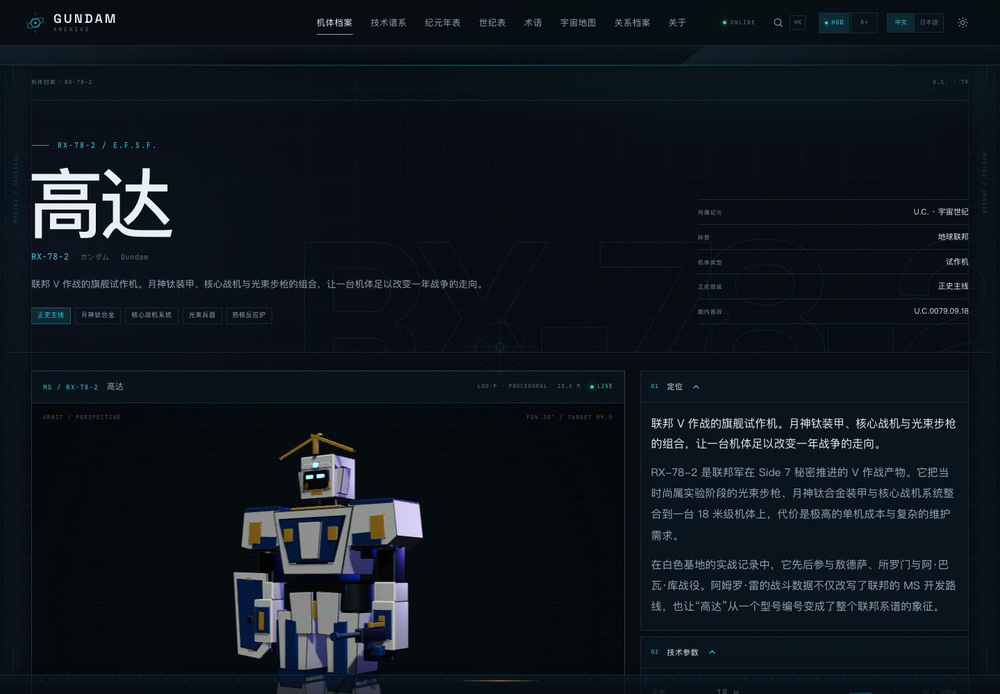
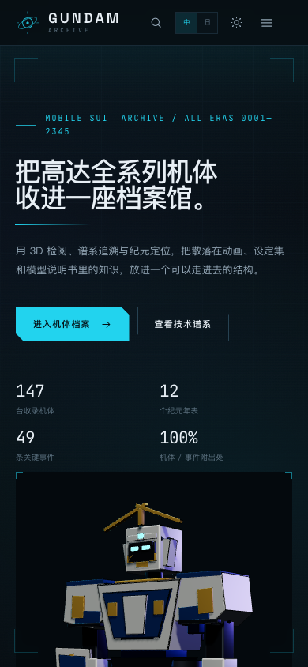
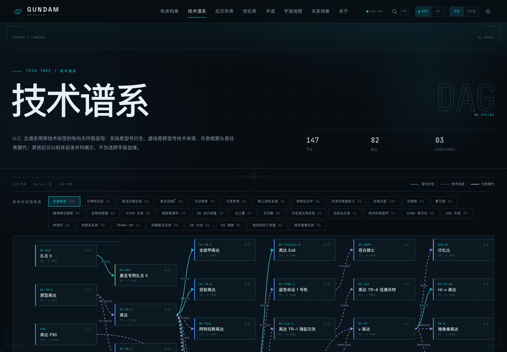
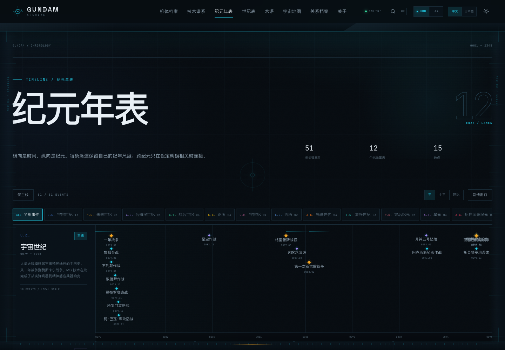
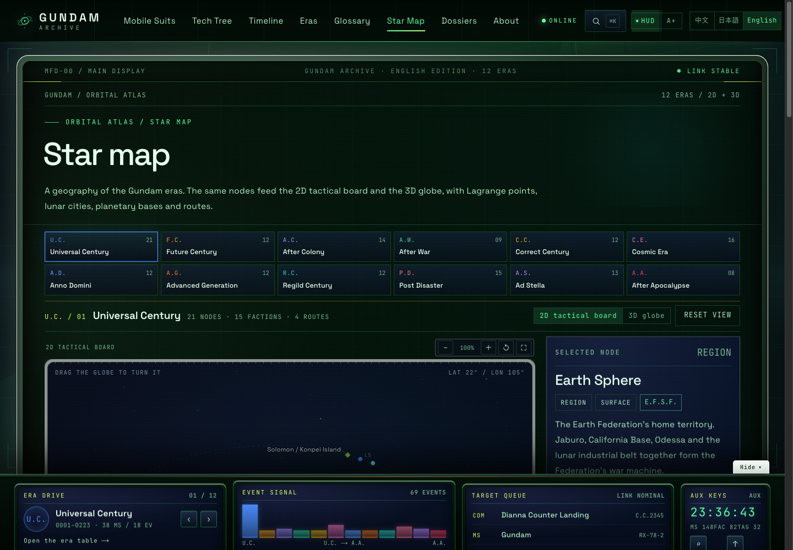
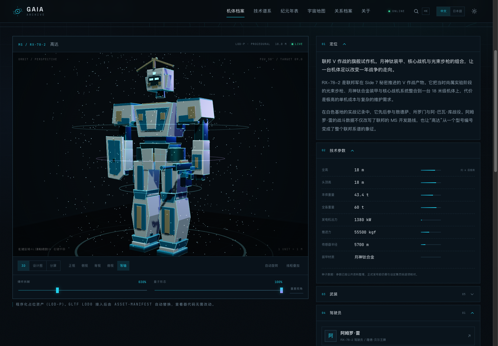

# GUNDAM Archive · 机动战士档案

[中文](README.md) ｜ [日本語](README.ja.md) ｜ [在线站点](https://cxy2696.github.io/GUNDAM-archive/zh/) ｜ [GitHub](https://github.com/cxy2696/GUNDAM-archive)

> 一座可交互、可追溯、可维护的机动战士档案馆。  
> 3D 检阅 · 技术谱系 · 纪元年表 · 地球圈地图 · 中日双语

**Next.js 15 · React 19 · TypeScript · Three.js / R3F · Zod · 静态导出 · JSON 驱动**

> 非官方粉丝考据项目，与 Bandai Namco / 创通・Sunrise 无关联。代码 MIT，原创内容 CC BY-NC-SA 4.0。详见 [NOTICE](NOTICE)。


## 项目概览

高达系列横跨多个纪元与作品，资料分散在动画、设定集、模型说明书与社区 Wiki 中。机体参数口径不一、纪元年表彼此割裂，技术演进需要读者在十几部作品之间来回比对。

GUNDAM Archive 把散落的知识组织成**可交互、可追溯、可继续生长**的结构，而不是再做一个资料站。

| 主线 | 用户问题 | 对应能力 |
| --- | --- | --- |
| **检阅** Inspect | 这台机体长什么样？由哪些部件构成？ | 3D 查看器、爆炸拆解、分件高亮、量子形态、2D 分层设计图 |
| **追溯** Trace | 它从哪里来？后来变成了什么？ | 带技术标签的有向无环谱系图，三种边类型，每条边附出处 |
| **定位** Locate | 它在哪一年、哪场战争、哪个地点出现？ | 十一纪元泳道年表、地球圈/拉格朗日点示意地图、事件抽屉 |

当前内容：**40 台机体 · 11 个纪元 · 28 条事件 · 27 个势力 · 12 位人物 · 23 部作品 · 15 个地点 · 23 个受控标签 · 19 条谱系边**；`/zh` 与 `/ja` 双语，共 **176 个静态页面**，构建期生成 130 条检索索引。

## 在线访问

| | |
| --- | --- |
| **中文站点** | https://cxy2696.github.io/GUNDAM-archive/zh/ |
| **日文站点** | https://cxy2696.github.io/GUNDAM-archive/ja/ |
| **仓库** | https://github.com/cxy2696/GUNDAM-archive |
| **Actions** | https://github.com/cxy2696/GUNDAM-archive/actions |
| **版本** | v1.1.0 |

站点由 GitHub Actions 静态构建并部署到 GitHub Pages。仓库为 public；如需私有化，可在 Settings → General → Danger Zone 调整。

## 界面

| 首页 · 3D 检阅 | 机体索引 · 40 台 |
| --- | --- |
|  |  |

| 机体档案 · 参数与谱系 | 移动端 · 语言切换 |
| --- | --- |
|  |  |

| 技术谱系 | 纪元年表 |
| --- | --- |
|  |  |

| 宇宙地图 | 量子形态 |
| --- | --- |
|  |  |

设计与工程图联动见 [preview/design-sheet.png](preview/design-sheet.png)。

## 核心能力

- **检阅**：R3F 查看器支持轨道旋转、缩放、平移、视角预设、自动旋转、爆炸拆解、分件悬停、线框叠加；3D 引擎异步加载，不阻塞页面外壳。
- **量子形态**：0–100% 连续插值，粒子、能量环、装甲色相偏移与自发光同步；可在控制台随时关闭。
- **2D / 3D 联动**：3D、设计图、分屏三态；SVG 分层图与 3D 共享 `partId`，悬停双向高亮，支持工程图模式。
- **技术谱系**：U.C. 主谱系 DAG + 平行纪元机体目录，40 台、19 条边；`derive_of` / `tech_from` / `replace` 三种边，标签高亮与构建期无环校验。
- **纪元年表**：七条泳道保留各自纪年尺度；年/十年/世纪刻度、主线过滤、U.C. 全史切换、事件详情抽屉。
- **关系档案**：势力组织树、五类关系、人物任期与驾驶机体、作品索引；`⌘K` 全局检索 + 独立检索页。
- **中日双语**：`/zh` 与 `/ja` 路由，hreflang/canonical；桌面、移动端与页脚均可切换，保留路径、查询串、锚点与滚动位置；首次访问按浏览器语言选择入口。

## 快速开始

要求 Node.js ≥ 20.9（推荐 22）。

```bash
git clone https://github.com/cxy2696/GUNDAM-archive.git
cd GUNDAM-archive

pnpm install        # 或 npm install
pnpm dev            # http://localhost:3000
pnpm validate       # 内容 schema / 外键 / 谱系 / 双向关联
pnpm typecheck
pnpm build          # 静态导出到 out/
pnpm preview        # 本地预览 out/（需要 python3）
```

> 仓库使用 pnpm 锁文件；GitHub Actions 使用 pnpm。本地用 npm 运行脚本也可以。

## 内容即数据

新增一台机体不需要改页面代码：

1. 复制 [docs/templates/machine.template.json](docs/templates/machine.template.json) 到 `content/machines/<slug>.json`。
2. 填写名称、参数、武装、标签、驾驶员、事件、查看器配置与 `sources`；没有的参数写 `null`，不要估算。
3. 在相关机体补谱系边；每条边必须有 `sources`，且 `to` 指向已存在机体。
4. 若参与事件，在 `content/events.json` 补 `machineIds`，保持双向回指。
5. 运行 `pnpm validate && pnpm build`。

路由、卡片、检索索引、谱系图、年表、地图、势力与人物页会自动读取新数据。字段定义见 [DATA_DICTIONARY](docs/DATA_DICTIONARY.md)，操作步骤见 [CONTENT_GUIDE](docs/CONTENT_GUIDE.md)。

## 架构

```
content/*.json
   │  fs + JSON.parse（构建期，仅服务端）
   ▼
src/lib/schema.ts      Zod schema + 类型（唯一真相源）
src/lib/content.ts     解析、跨文件校验、查询
src/lib/tree.ts        DAG 布局
src/lib/search-index.ts
   ▼
app/(site)/[lang]      React Server Components → 176 个静态页面
   ▼
next build (output: export) → out/ → GitHub Pages
```

- **单一真相源**：`src/lib/schema.ts` 同时约束数据结构与 TypeScript 类型。
- **静态优先**：无数据库、无服务端运行时；内容更新 = 改 JSON → 校验 → 重建。
- **按需 3D**：页面外壳与 R3F Stage 分离，3D chunk 独立下载。
- **契约先行**：程序化 LOD-P 与未来 glTF 共用 `partId / axis / order / manifest`。

完整分层、决策记录与迁移路径见 [ARCHITECTURE](docs/ARCHITECTURE.md)。

## 文档地图

| 文档 | 负责什么 |
| --- | --- |
| [README.ja.md](README.ja.md) | 日本語の概要・起動方法 |
| [docs/README.md](docs/README.md) | 文档索引、权威边界、更新规则 |
| [docs/ARCHITECTURE.md](docs/ARCHITECTURE.md) | 六层模型、数据流、查看器、部署、ADR、迁移 |
| [docs/CONTENT_GUIDE.md](docs/CONTENT_GUIDE.md) | 新增/修改内容、双语、审校清单、常见错误 |
| [docs/DATA_DICTIONARY.md](docs/DATA_DICTIONARY.md) | 字段、枚举、单位、日期、校验规则（字段级权威） |
| [docs/ASSET_PIPELINE.md](docs/ASSET_PIPELINE.md) | LOD、partId、manifest、Blender→glTF、验收 |
| [docs/DATA_SOURCES.md](docs/DATA_SOURCES.md) | 外部资料源、合法接入流程、官方图版权边界 |
| [docs/GOVERNANCE.md](docs/GOVERNANCE.md) | 来源分级、争议、版权、审核、AI 规则 |
| [docs/DESIGN_SYSTEM.md](docs/DESIGN_SYSTEM.md) | Token、字体、组件、动效、可访问性 |
| [docs/ROADMAP.md](docs/ROADMAP.md) | M0–M5、V1.1、内容批次、风险 |
| [CONTRIBUTING.md](CONTRIBUTING.md) | 开发/内容贡献流程、PR 要求 |
| [CHANGELOG.md](CHANGELOG.md) | 版本变更 |

> 权威顺序：`src/lib/schema.ts` → `DATA_DICTIONARY` → 其他文档。文档之间不重复维护字段表；新增字段先改 schema，再更新数据字典与指南。

## 质量门禁

`pnpm validate` 在构建前检查：

- **Schema**：字段类型、必填、枚举、slug 格式；
- **引用**：纪元/势力/人物/作品/地点/事件/标签/机体外键全部可解析；
- **谱系**：忽略 `replace` 后无环，边必须有出处，不能自指；
- **双向关联**：机体驾驶员 ↔ 人物机体；机体事件 ↔ 事件机体；人物事件 ↔ 事件人物；
- **构建**：`next build` 在内容错误时失败。

双语字段的完整性由 schema 强制（`zh` / `ja` 必填）；数值与专有名词的一致性仍需人工二审，见 CONTENT_GUIDE。

## 部署

| 平台 | 方式 |
| --- | --- |
| GitHub Pages | `.github/workflows/deploy-pages.yml`，自动设置 `NEXT_PUBLIC_BASE_PATH=/GUNDAM-archive` |
| Vercel / Cloudflare / Netlify | 构建命令 `pnpm build`，输出目录 `out` |

| 变量 | 用途 | 默认 |
| --- | --- | --- |
| `NEXT_PUBLIC_BASE_PATH` | 子路径部署前缀 | 空 |
| `NEXT_PUBLIC_SITE_URL` | canonical / sitemap / OG 的绝对地址 | `https://cxy2696.github.io/GUNDAM-archive` |

## 已知边界

- **范围说明**：当前收录 **40 台主线 Gundam 型机体**，覆盖 11 个纪元；不是字面意义上的全部衍生型号。外传、游戏原创与量产衍生型号列入 B3/B4 目录，继续补全。
- **3D 是程序化 LOD-P 占位**，不是官方模型，也不是最终 glTF；分件、装配轴、爆炸顺序已按 `partId` 组织，接入 LOD0 不改查看器。
- **不使用官方设计图**：当前视觉为自绘 SVG / 程序化 3D；官方图、扫描设定集与 Wiki 图片不转存、不热链，授权素材的接入规则见 [DATA_SOURCES](docs/DATA_SOURCES.md)。
- **数据是种子数据**：参数按公开资料整理，尚未逐项核对到设定集页码；界面标 `seed` 与 `disputed`。
- **出处覆盖不完整**：机体与事件有 `sources`；势力、人物、作品、地点、标签目前通过作品锚定，尚未逐条挂 `source_refs`。这是 M4 的明确任务，不把“有出处”说成全覆盖。
- **没有后端/数据库/Admin**；检索是构建期索引，更新走重新构建。
- 检索暂未做拼音/罗马字模糊匹配；视觉回归与真机性能门禁尚未接入（M4）。

## License

- **代码**：[MIT](LICENSE)
- **原创文本、图表、SVG、程序化几何**：[CC BY-NC-SA 4.0](https://creativecommons.org/licenses/by-nc-sa/4.0/)
- **高达系列及相关名称、设定**：权利归创通・Sunrise / Bandai Namco；本项目为非商业粉丝作品，不含官方美术或模型素材。完整声明见 [NOTICE](NOTICE)。

---

**English tl;dr** — GUNDAM Archive is an unofficial, non-commercial, bilingual mobile-suit knowledge archive. It is a static Next.js 15 app with JSON content validated by Zod at build time, a procedural Three.js viewer (exploded view, part hover, quantum mode), a DAG tech tree, an eleven-era timeline, and a schematic Earth-sphere map. Content is data, not code: add a JSON file, run `pnpm validate && pnpm build`. Code is MIT; original content is CC BY-NC-SA 4.0.
