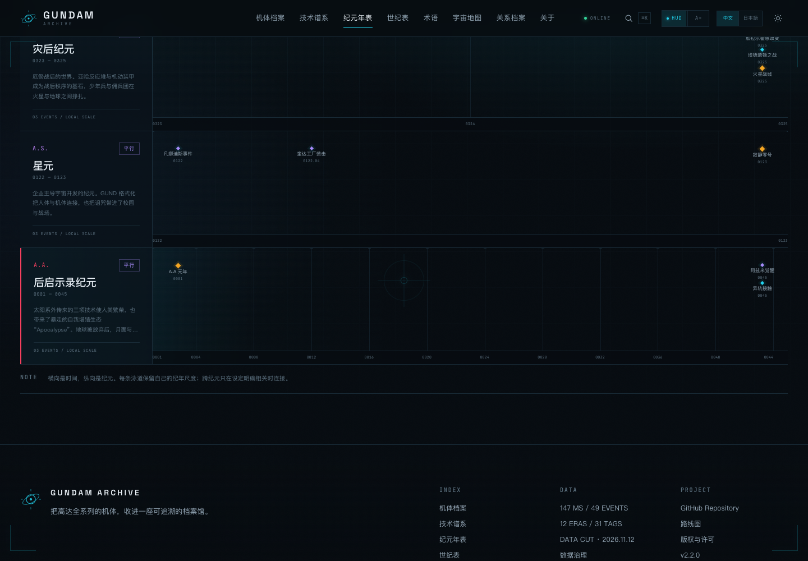
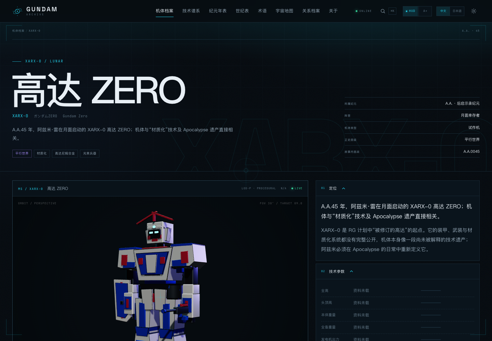
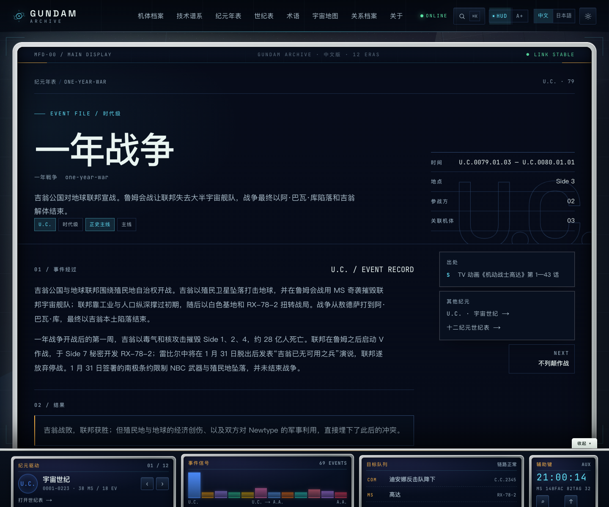
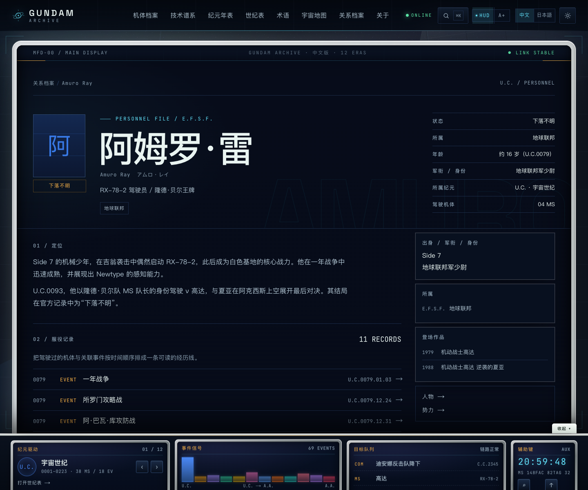
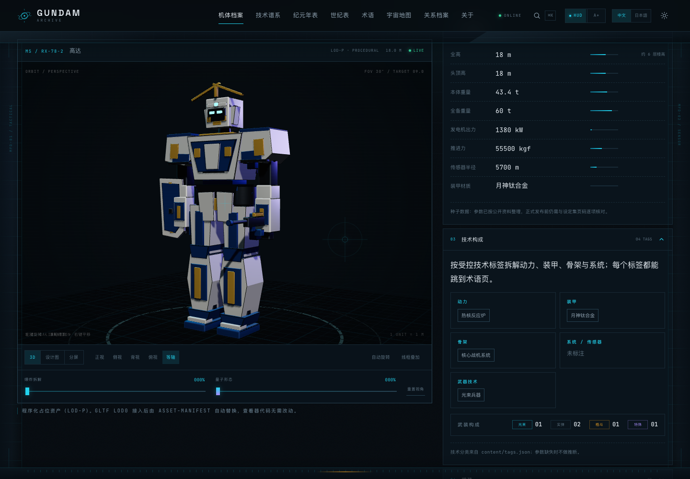
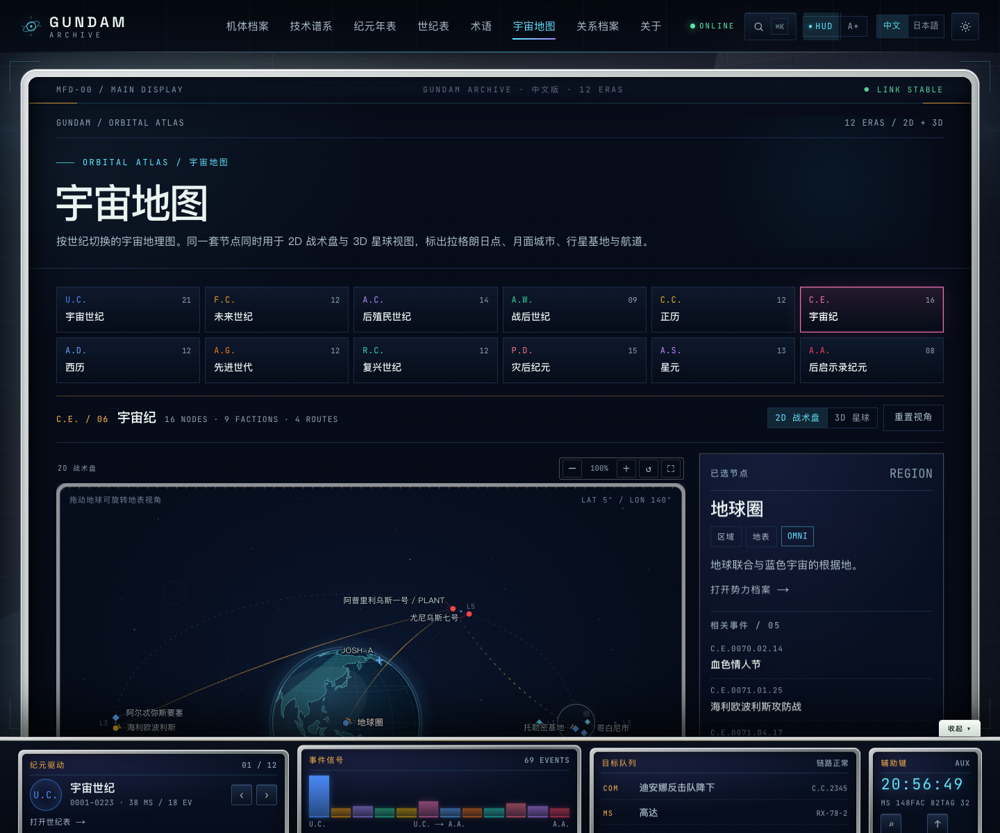
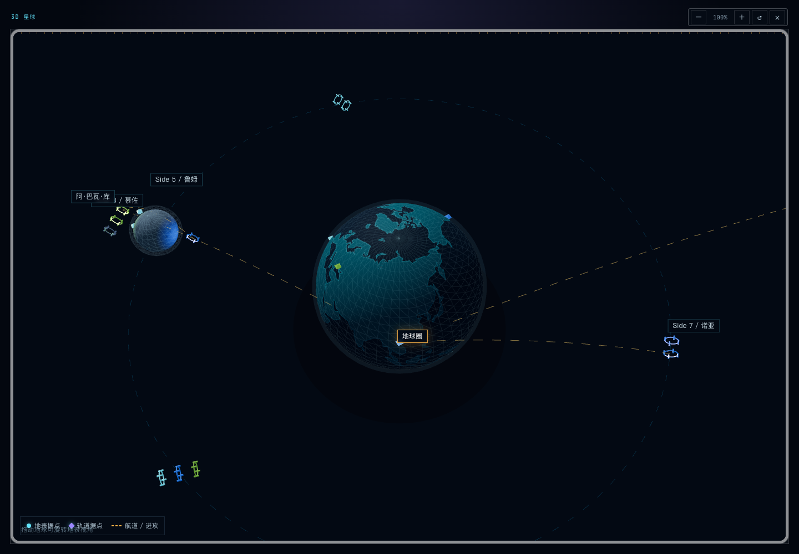
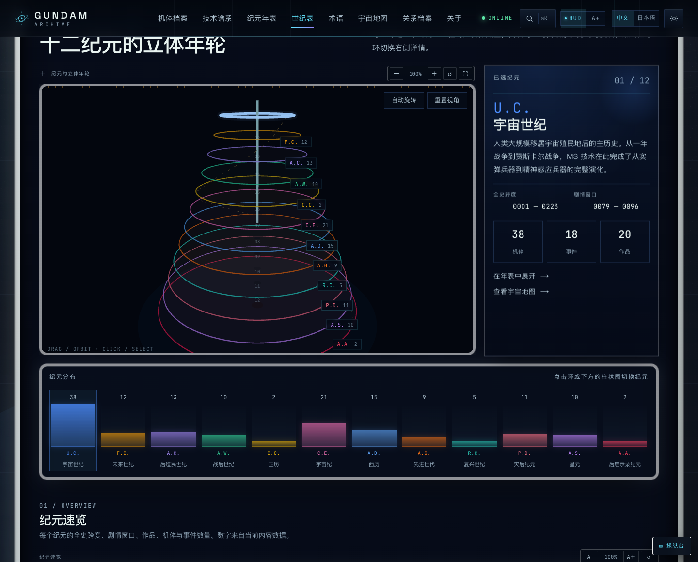
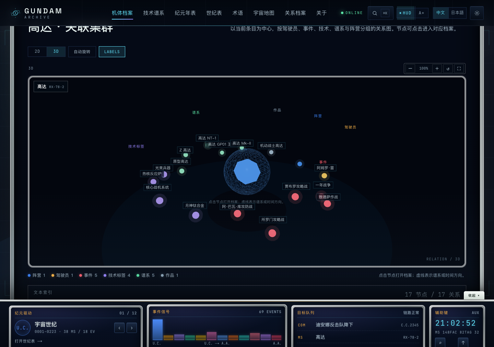

# GUNDAM Archive · 机动战士档案

[中文](README.md) ｜ [日本語](README.ja.md) ｜ [在线站点](https://cxy2696.github.io/GUNDAM-archive/zh/) ｜ [GitHub](https://github.com/cxy2696/GUNDAM-archive)

> 一座可交互、可追溯、可维护的机动战士档案馆。  
> 3D 检阅 · 技术谱系 · 纪元年表 · 地球圈地图 · 中日双语

**Next.js 15 · React 19 · TypeScript · Three.js / R3F · Zod · 静态导出 · JSON 驱动**

> 非官方粉丝考据项目，与 Bandai Namco / 创通・Sunrise 无关联。代码 MIT，原创内容 CC BY-NC-SA 4.0。详见 [NOTICE](NOTICE)。

## 30 秒读懂

- **这是什么**：一个静态的、JSON 驱动的高达档案站，把机体、纪年、谱系、人物与出处放在同一个可读结构里。
- **现在有什么**：**148 台机体 · 12 个纪元 · 114 位人物 · 42 部作品 · 69 条事件 · 82 个势力 · 32 个受控标签 · 116 条谱系边 · 156 个地图节点**；`/zh` 与 `/ja` 双语，共 **854 个静态页面**。
- **先看哪三页**：[世纪表](https://cxy2696.github.io/GUNDAM-archive/zh/chronology/) 看全系列 → [机体总表](https://cxy2696.github.io/GUNDAM-archive/zh/chronology/#roster-title) 查所有机体 → [覆盖说明](docs/MACHINE_COVERAGE.md) 看收录边界。
- **可信度**：机体与事件有 `sources`；未核对参数标 `seed`，冲突标 `disputed`；没有的参数显示“资料未载”，不估算。

> **范围**：收录 11 个正史纪元的高达型主线机体与核心外传机体，另保留 2 台 A.A. 原创扩展。不是 5,000+ 全衍生型号图鉴，也不含官方设计图。收录规则见 [MACHINE_COVERAGE](docs/MACHINE_COVERAGE.md)。

## 这次更新（V3.1）

| 你关心的 | 现在有什么 |
| --- | --- |
| **驾驶舱界面** | 座舱式外壳：舱盖视角、金属边框主屏、MFD 侧栏（≥1760px）、固定操纵台与移动端抽屉；主屏顶部有 MFD 状态条，底部操纵台可切换纪元、看事件分布、跳转最新事件与样本机体 |
| **虚化相框与悬浮** | 主屏、地图、谱系、世纪表、关联图、操纵台都包在白色毛玻璃相框中；MFD 侧栏与操纵台卡片上下错落，鼠标悬停轻微上浮；操纵台可“收起”，正文不被遮挡 |
| **缩放与全屏** | 地图/3D 星球/关联图/纪元年轮有 − / + / 重置 / 全屏；世纪表有 A− / A+ 文字缩放；技术谱系有缩放、适应宽度与全屏 |
| **关联图 3D** | 机体、人物、事件、势力、术语、关系档案的关联图全部可在 2D / 3D 间切换；3D 支持旋转、自动旋转、标签开关与节点跳转 |
| **字体与可读性** | 全部字号整体上调：正文 17px，微小标签 12px，按钮/表格/导航 13–15px；`A+ / A−` 大字模式再放大一档；表格、时间轴、技术谱系和关系图都按新字号重排 |
| **宇宙地图** | `/[lang]/map` 重做为 **12 纪元星图**：156 个节点、U.C. 到 A.A. 全纪元；每个纪元都有 **2D 战术盘 + 3D WebGL 星球** 切换。U.C. 使用一年战争（0084 前）编制并注明 0084 年 Side 4/5/6 三向重编；C.E.、A.D.、R.C.、P.D.、A.W. 等按官方地理校正 |
| **世纪表 / 年表** | 世纪表新增 **3D 纪元年轮**：十二个环按机体数定半径、按世纪定高度，可旋转、点击切换、自动旋转；下方新增十二列机体分布图。年表的事件标签改为左右锚定 + 54px 行距，不再在右缘堆叠 |
| **关系档案** | 新增按世纪切换的 **势力关系图**：同盟、敌对、分裂、继承四种关系用不同颜色连线；每个节点显示机体/人物数量。势力从 57 增至 **82**，每个纪元至少 5 个 |
| **关联集群** | 机体、人物、事件、势力、术语页都新增放射状 **关联集群图**：按驾驶员/事件/技术/谱系/阵营分区，附文本索引与可点击节点。人物关系覆盖从 18 人增至 **97 人** |
| **术语检索** | 术语页新增 **检索导图**（按类别分布的气泡图，气泡大小=使用机体数）与 **关联树**（选中术语后展示使用机体、势力、纪元、共现技术） |
| **技术谱系** | 新增机体/型号搜索、−/+/适应宽度缩放、代际标尺、悬停直连高亮；十二个纪元标签在桌面端自动换行 |
| **检索** | 检索索引扩展到驾驶员、别名、摘要、详情、势力、技术与作品；新增精确/前缀/多词/拉丁拼写模糊匹配、类型加权、`?q=` 分享链接、快速入口与纪元快捷跳转 |
| **缩放与 3D** | 地图、技术谱系、世纪表、术语导图与全部关联图都支持缩放（地图/纪元年轮/关联图另有全屏）；关联图可在 2D 与 3D 之间切换，3D 可旋转、自动旋转、开关标签 |
| **模型细节** | 程序化 3D 机体补上胸甲接缝、驾驶舱盖、肩部喷口、肘/前臂装甲、膝甲、小腿散热口、脚踝作动筒、背包喷口与头部颊部通风口 |
| **事件细节** | 事件从 51 条增至 **69 条**，新增海利欧波利斯、Spitbreak、弥赛亚、天使陨落、多特暴动、维恩戈尔夫、哈什马尔、昆港、阿斯提卡西亚、天秤座、桑克、云九、迪安娜降下、诺拉、圣波特、洗牌同盟等 18 条；20 个关键事件各补一段经过/结果说明；事件列表日期列加宽 |
| **中文/日文** | 以上 UI 文案与新增内容均为双语；语言门禁与内容校验继续通过 |

## 怎么读这个站

1. **先看世纪表**：一分钟版表格告诉你每个纪元的历法、跨度、作品与机体数量；再展开任一纪元的全机体总表。
2. **再进机体页**：每台机体都有纪元、势力、初登场、武装、驾驶员、谱系边与出处；3D 为程序化预览，不是官方模型。
3. **想追技术路线**：打开 [技术谱系](https://cxy2696.github.io/GUNDAM-archive/zh/tech-tree/)，按技术标签高亮；每条边都能回到两台机体。
4. **遇到不懂的词**：打开 [术语与技术词条](https://cxy2696.github.io/GUNDAM-archive/zh/glossary/)，按类别筛选或直接搜索；每个词条都列出使用它的机体。
5. **想看完整事件**：在年表点开事件抽屉，或直接进入事件档案页；那里有经过、结果、参战方与前后事件。
6. **想改内容**：从 [CONTENT_GUIDE](docs/CONTENT_GUIDE.md) 开始；新增机体不需要改页面代码。

## 怎么读这个站

1. **先看世纪表**：一分钟版表格告诉你每个纪元的历法、跨度、作品与机体数量；再展开任一纪元的全机体总表。
2. **再进机体页**：每台机体都有纪元、势力、初登场、武装、驾驶员、谱系边与出处；3D 为程序化预览，不是官方模型。
3. **想追技术路线**：打开 [技术谱系](https://cxy2696.github.io/GUNDAM-archive/zh/tech-tree/)，按技术标签高亮；每条边都能回到两台机体。
4. **想改内容**：从 [CONTENT_GUIDE](docs/CONTENT_GUIDE.md) 开始；新增机体不需要改页面代码。


## 项目概览

高达系列横跨多个纪元与作品，资料分散在动画、设定集、模型说明书与社区 Wiki 中。机体参数口径不一、纪元年表彼此割裂，技术演进往往要翻十几部作品才能比对。

GUNDAM Archive 把散落的知识组织成**可交互、可追溯、可继续生长**的结构，而不是再做一个资料站。

| 主线 | 用户问题 | 对应能力 |
| --- | --- | --- |
| **检阅** Inspect | 这台机体长什么样？由哪些部件构成？ | 3D 查看器、爆炸拆解、分件高亮、量子形态、2D 分层设计图 |
| **追溯** Trace | 它从哪里来？后来变成了什么？ | 带技术标签的有向无环谱系图，三种边类型，每条边附出处 |
| **定位** Locate | 它在哪一年、哪场战争、哪个地点出现？ | 十二纪元泳道年表、地球圈/拉格朗日点示意地图、事件抽屉 |

A.A. 后启示录是本仓库的原创扩展纪元：XARX-0 高达 ZERO、螺旋高达，以及《机动战士高达 RG XARX-ZERO》《GUNDAM 异轨征途》两部作品；它与 11 个正史纪元分开阅读。

| A.A. 年表 | XARX-0 高达 ZERO |
| --- | --- |
|  |  |

当前内容：**148 台机体 · 12 个纪元 · 69 条事件 · 82 个势力 · 114 位人物 · 42 部作品 · 15 个地点 · 32 个受控标签 · 116 条谱系边 · 156 个地图节点**；`/zh` 与 `/ja` 双语，共 **854 个静态页面**，构建期生成 **487 条检索索引**。

## 在线访问

| | |
| --- | --- |
| **中文站点** | https://cxy2696.github.io/GUNDAM-archive/zh/ |
| **日文站点** | https://cxy2696.github.io/GUNDAM-archive/ja/ |
| **仓库** | https://github.com/cxy2696/GUNDAM-archive |
| **Actions** | https://github.com/cxy2696/GUNDAM-archive/actions |
| **版本** | v3.1.0 |

站点由 GitHub Actions 静态构建并部署到 GitHub Pages。仓库为 public；如需私有化，可在 Settings → General → Danger Zone 调整。

## 界面

| 首页 · 3D 检阅 | 机体索引 · 148 台 |
| --- | --- |
|  |  |

| 机体档案 · 参数与谱系 | 移动端 · 语言切换 |
| --- | --- |
|  |  |

| 术语与技术词条 · 32 条 | 事件档案 · 69 条 |
| --- | --- |
|  |  |

| 人物档案 · 服役记录 | 技术构成 · 动力/装甲/骨架 |
| --- | --- |
|  |  |

| MS 谱系 · 116 条边 | 纪元年表 |
| --- | --- |
|  |  |

| 宇宙地图 · U.C. | 宇宙地图 · C.E. 势力 |
| --- | --- |
|  |  |

| 宇宙地图 · 3D 星球 | 世纪表 · 3D 年轮 |
| --- | --- |
|  |  |

| 关联集群 · 3D | 术语检索导图 |
| --- | --- |
|  |  |

| 十二纪元世纪表 |
| --- |
|  |

设计与工程图联动见 [preview/design-sheet.png](preview/design-sheet.png)。

## 核心能力

- **检阅**：R3F 查看器支持轨道旋转、缩放、平移、视角预设、自动旋转、爆炸拆解、分件悬停、线框叠加；3D 引擎异步加载，不阻塞页面外壳。
- **量子形态**：0–100% 连续插值，粒子、能量环、装甲色相偏移与自发光同步；可在控制台随时关闭。
- **2D / 3D 联动**：3D、设计图、分屏三态；SVG 分层图与 3D 共享 `partId`，悬停双向高亮，支持工程图模式。
- **技术构成**：每台机体都有动力、装甲、骨架、系统与武装构成面板，技术标签可直接跳到术语页。
- **技术谱系**：按纪元切换的 DAG，148 台、116 条边；`derive_of` / `tech_from` / `replace` 三种边，标签高亮与构建期无环校验。
- **纪元年表**：十二纪元泳道保留各自纪年尺度；年/十年/世纪刻度、主线过滤、U.C. 全史切换、事件详情抽屉。
- **关系档案**：势力组织树、五类关系、人物任期与驾驶机体、作品索引；`⌘K` 全局检索 + 独立检索页。
- **人物经历**：114 位人物的年龄、军衔/身份、出身与“服役记录”；驾驶机体与关联事件按时间排序，可直接跳到事件档案。
- **事件档案**：51 个事件全部有“事件经过”长文与独立档案页，包含结果、参战方、关联机体、人物、出处与前后事件。
- **术语与技术词条**：32 个受控技术标签逐条解释，按装甲/动力/传感/武器/系统/骨架分类筛选；另设 12 个阅读术语。
- **驾驶舱 HUD 与阅读模式**：HUD 开关、扫描线、准星、链路状态；`A+ / A−` 切换大字模式，正文与卡片同步放大。
- **中日双语**：`/zh` 与 `/ja` 路由，hreflang/canonical；桌面、移动端与页脚均可切换，保留路径、查询串、锚点与滚动位置；首次访问按浏览器语言选择入口。

## 快速开始

要求 Node.js ≥ 20.9（推荐 22）。

```bash
git clone https://github.com/cxy2696/GUNDAM-archive.git
cd GUNDAM-archive

pnpm install        # 或 npm install
pnpm dev            # http://localhost:3000
pnpm validate       # 内容 schema / 外键 / 谱系 / 双向关联
pnpm language:check # 编辑语言门禁（模板句、长度）
pnpm typecheck
pnpm build          # 静态导出到 out/
pnpm preview        # 本地预览 out/（需要 python3）
```

> 仓库使用 pnpm 锁文件；GitHub Actions 使用 pnpm。本地用 npm 运行脚本也可以。

## 内容即数据

新增一台机体不需要改页面代码：

1. 复制 [docs/templates/machine.template.json](docs/templates/machine.template.json) 到 `content/machines/<slug>.json`。
2. 填写名称、参数、武装、标签、驾驶员、事件、查看器配置与 `sources`；没有的参数写 `null`，不要估算。
3. 在相关机体补谱系边；每条边必须有 `sources`，且 `to` 指向已存在机体。
4. 若参与事件，在 `content/events.json` 补 `machineIds`，保持双向回指。
5. 运行 `pnpm validate && pnpm build`。

路由、卡片、检索索引、谱系图、年表、地图、势力与人物页会自动读取新数据。字段定义见 [DATA_DICTIONARY](docs/DATA_DICTIONARY.md)，操作步骤见 [CONTENT_GUIDE](docs/CONTENT_GUIDE.md)。

## 架构

```
content/*.json
   │  fs + JSON.parse（构建期，仅服务端）
   ▼
src/lib/schema.ts      Zod schema + 类型（唯一真相源）
src/lib/content.ts     解析、跨文件校验、查询
src/lib/tree.ts        DAG 布局
src/lib/search-index.ts
   ▼
app/(site)/[lang]      React Server Components → 854 个静态页面
   ▼
next build (output: export) → out/ → GitHub Pages
```

- **单一真相源**：`src/lib/schema.ts` 同时约束数据结构与 TypeScript 类型。
- **静态优先**：无数据库、无服务端运行时；内容更新 = 改 JSON → 校验 → 重建。
- **按需 3D**：页面外壳与 R3F Stage 分离，3D chunk 独立下载。
- **契约先行**：程序化 LOD-P 与未来 glTF 共用 `partId / axis / order / manifest`。

完整分层、决策记录与迁移路径见 [ARCHITECTURE](docs/ARCHITECTURE.md)。

## 文档地图

| 文档 | 负责什么 |
| --- | --- |
| [README.ja.md](README.ja.md) | 日本語の概要・起動方法 |
| [docs/README.md](docs/README.md) | 文档索引、权威边界、更新规则 |
| [docs/CHRONOLOGY.md](docs/CHRONOLOGY.md) | 十二纪元世纪表、逐纪元速查、阅读顺序 |
| [docs/EDITORIAL.md](docs/EDITORIAL.md) | 编辑风格、禁用模板句、事实与长度规则 |
| [docs/MACHINE_COVERAGE.md](docs/MACHINE_COVERAGE.md) | “全机体”的收录规则、覆盖矩阵、明确不包含什么 |
| [docs/ARCHITECTURE.md](docs/ARCHITECTURE.md) | 六层模型、数据流、查看器、部署、ADR、迁移 |
| [docs/CONTENT_GUIDE.md](docs/CONTENT_GUIDE.md) | 新增/修改内容、双语、审校清单、常见错误 |
| [docs/DATA_DICTIONARY.md](docs/DATA_DICTIONARY.md) | 字段、枚举、单位、日期、校验规则（字段级权威） |
| [docs/ASSET_PIPELINE.md](docs/ASSET_PIPELINE.md) | LOD、partId、manifest、Blender→glTF、验收 |
| [docs/DATA_SOURCES.md](docs/DATA_SOURCES.md) | 外部资料源、合法接入流程、官方图版权边界 |
| [docs/GLOSSARY.md](docs/GLOSSARY.md) | 纪元、字段、工程词的人类可读解释 |
| [docs/GOVERNANCE.md](docs/GOVERNANCE.md) | 来源分级、争议、版权、审核、AI 规则 |
| [docs/DESIGN_SYSTEM.md](docs/DESIGN_SYSTEM.md) | Token、字体、组件、动效、可访问性 |
| [docs/ROADMAP.md](docs/ROADMAP.md) | M0–M5、V2.x、内容批次、风险 |
| [CONTRIBUTING.md](CONTRIBUTING.md) | 开发/内容贡献流程、PR 要求 |
| [CHANGELOG.md](CHANGELOG.md) | 版本变更 |

> 权威顺序：`src/lib/schema.ts` → `DATA_DICTIONARY` → 其他文档。文档之间不重复维护字段表；新增字段先改 schema，再更新数据字典与指南。

## 按问题找文档

| 我想…… | 先读 |
| --- | --- |
| 快速理解全系列 | [世纪表](docs/CHRONOLOGY.md) → [术语表](docs/GLOSSARY.md) |
| 知道“到底收了哪些机体” | [机体覆盖表](docs/MACHINE_COVERAGE.md) |
| 新增一台机体 / 事件 / 人物 | [CONTENT_GUIDE](docs/CONTENT_GUIDE.md) → [DATA_DICTIONARY](docs/DATA_DICTIONARY.md) |
| 改字段或校验规则 | `src/lib/schema.ts` → [DATA_DICTIONARY](docs/DATA_DICTIONARY.md) |
| 判断出处能不能用 | [GOVERNANCE](docs/GOVERNANCE.md) → [DATA_SOURCES](docs/DATA_SOURCES.md) |
| 接 3D 资产 | [ASSET_PIPELINE](docs/ASSET_PIPELINE.md) |
| 看下一步计划 | [ROADMAP](docs/ROADMAP.md) → [CHANGELOG](CHANGELOG.md) |

## 质量门禁

`pnpm validate` 在构建前检查：

- **Schema**：字段类型、必填、枚举、slug 格式；
- **引用**：纪元/势力/人物/作品/地点/事件/标签/机体外键全部可解析；
- **谱系**：忽略 `replace` 后无环，边必须有出处，不能自指；
- **双向关联**：机体驾驶员 ↔ 人物机体；机体事件 ↔ 事件机体；人物事件 ↔ 事件人物；
- **解释完整性**：每个技术标签与事件必须有 `detail` 长解释；每位人物必须有 `age / rank / origin`；
- **语言**：`language:check` 扫描高频 AI 模板句、过长摘要与段落；
- **构建**：`next build` 在内容错误时失败。

双语字段的完整性由 schema 强制（`zh` / `ja` 必填）；数值与专有名词的一致性仍需人工二审，见 CONTENT_GUIDE。

## 部署

| 平台 | 方式 |
| --- | --- |
| GitHub Pages | `.github/workflows/deploy-pages.yml`，自动设置 `NEXT_PUBLIC_BASE_PATH=/GUNDAM-archive` |
| Vercel / Cloudflare / Netlify | 构建命令 `pnpm build`，输出目录 `out` |

| 变量 | 用途 | 默认 |
| --- | --- | --- |
| `NEXT_PUBLIC_BASE_PATH` | 子路径部署前缀 | 空 |
| `NEXT_PUBLIC_SITE_URL` | canonical / sitemap / OG 的绝对地址 | `https://cxy2696.github.io/GUNDAM-archive` |

## 已知边界

- **范围说明**：当前收录 **148 台机体**（146 台属于 11 个正史纪元，2 台为 A.A. 扩展），覆盖主线与核心外传；不是字面意义上的全部 5,000+ 衍生型号。收录规则、覆盖矩阵与“为什么 C.C. 只有 2 台”见 [MACHINE_COVERAGE](docs/MACHINE_COVERAGE.md)。
- **3D 是程序化 LOD-P 占位**，不是官方模型，也不是最终 glTF；分件、装配轴、爆炸顺序已按 `partId` 组织，接入 LOD0 不改查看器。
- **不使用官方设计图**：当前视觉为自绘 SVG / 程序化 3D；官方图、扫描设定集与 Wiki 图片不转存、不热链，授权素材的接入规则见 [DATA_SOURCES](docs/DATA_SOURCES.md)。
- **年龄/军衔/出身是公开设定整理**，标“约”的为推定；不同作品口径冲突时仍以 `seed` 呈现，不强行统一。
- **事件长解释是编辑重写**，不是官方原文；它服务于阅读，不替代设定集与正片。
- **数据是种子数据**：参数按公开资料整理，尚未逐项核对到设定集页码；界面标 `seed` 与 `disputed`。
- **出处覆盖不完整**：机体与事件有 `sources`；势力、人物、作品、地点、标签目前通过作品锚定，尚未逐条挂 `source_refs`。这是 M4 的明确任务，不把“有出处”说成全覆盖。
- **没有后端/数据库/Admin**；检索是构建期索引，更新走重新构建。
- 检索暂未做拼音/罗马字模糊匹配；视觉回归与真机性能门禁尚未接入（M4）。

## License

- **代码**：[MIT](LICENSE)
- **原创文本、图表、SVG、程序化几何**：[CC BY-NC-SA 4.0](https://creativecommons.org/licenses/by-nc-sa/4.0/)
- **高达系列及相关名称、设定**：权利归创通・Sunrise / Bandai Namco；本项目为非商业粉丝作品，不含官方美术或模型素材。完整声明见 [NOTICE](NOTICE)。

---

**English tl;dr** — GUNDAM Archive is an unofficial, non-commercial, bilingual mobile-suit knowledge archive. It is a static Next.js 15 app with JSON content validated by Zod at build time, a procedural Three.js viewer (exploded view, part hover, quantum mode), a DAG tech tree, an eleven-era timeline, and a schematic Earth-sphere map. Content is data, not code: add a JSON file, run `pnpm validate && pnpm build`. Code is MIT; original content is CC BY-NC-SA 4.0.
